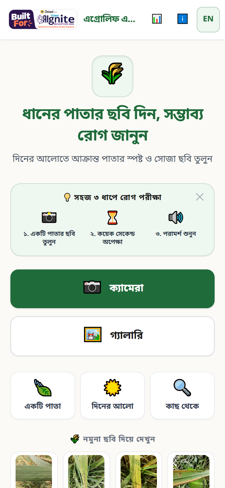
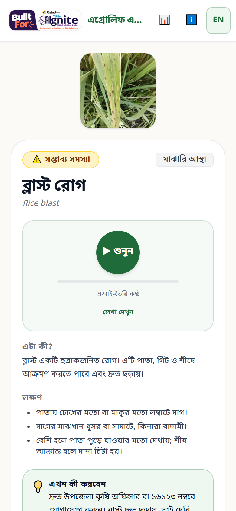
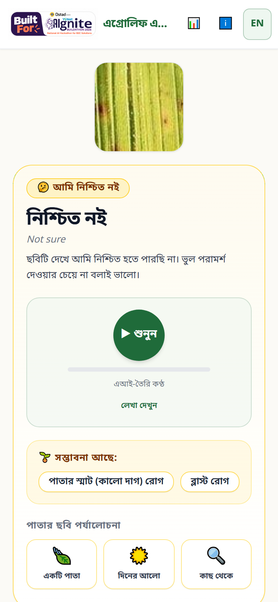
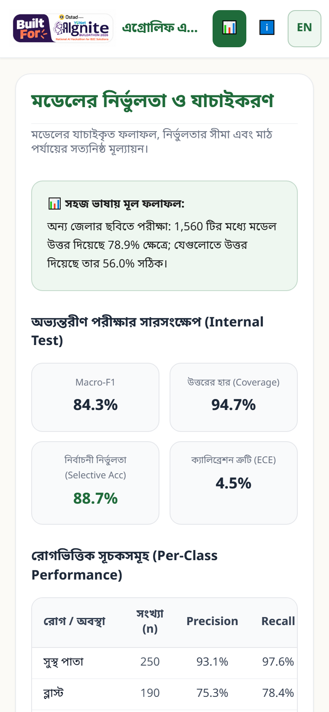
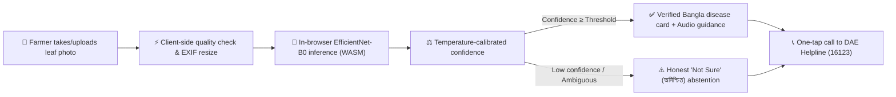

# AgroLeaf AI — এগ্রোলিফ এআই

**Private, on-device rice leaf disease screening and official agricultural guidance for smallholder farmers in Bangladesh.**

---

## Live demo
> 🔗 **Live Web App:** https://agroleaf-ai.pages.dev (production)  
> 🧪 **Release candidate (latest features, under final testing):** https://deploy-candidate-ready.agroleaf-ai.pages.dev

---

## Screenshots

| 1. Home & Onboarding | 2. Screening Result (Blast) | 3. Calibrated "Not Sure" | 4. In-App Accuracy & Transparency |
|:---:|:---:|:---:|:---:|
|  |  |  |  |

---

## The Problem
- **Crucial Staple Crop:** Rice feeds over 170 million people in Bangladesh, representing the livelihood foundation of millions of smallholder farming families.
- **Visual Ambiguity:** Fungal, bacterial, and viral foliar symptoms (e.g. Rice Blast vs Brown Spot vs Sheath Blight) often appear deceptively similar in early growth stages, leading farmers to misidentify infections.
- **Intermittent Rural Connectivity:** Remote rural fields across haors, chars, and upazilas frequently suffer from weak, intermittent mobile connectivity. Cloud-dependent upload models fail under high latency or zero signal.
- **Dangerous Chemical Guesswork:** Misdiagnosis frequently leads to excessive, mistimed, or inappropriate chemical spraying—wasting scarce farmer income, inducing pathogen resistance, and contaminating rural water bodies.

---

## How It Works



1. **Local Capture & Validation:** The farmer captures or selects a photo. The browser corrects EXIF orientation, resizes to max 1024 px, and checks for blur or darkness.
2. **On-Device Inference:** An EfficientNet-B0 model (v10, 8 outputs incl. "not a rice leaf" and "other rice problem", 15.3 MB ONNX) runs completely inside the browser via WebAssembly (`onnxruntime-web/wasm`). The image is **never** uploaded to any external server.
3. **Calibrated Abstention ("Not Sure"):** Rather than blindly predicting a class when uncertain, temperature-scaled confidence thresholds route ambiguous inputs to a safe "Not Sure" (অনিশ্চিত) state.
4. **Actionable Extension Guidance:** Displays vetted, official Bangladesh agricultural extension advice (BAMIS/DAE) in native Bangla, plays tap-to-play voice narration, and provides one-click calling to the national helpline `16123`.

---

## Key Features
- **Private, on-device image inference:** Image diagnosis runs 100% on-device in the browser; leaf photos are never uploaded to any server. Once assets are cached by the Service Worker after the first visit, photo screening works completely offline. Optional auxiliary features (7-day weather forecast, GPS geocoding proxy, community alerts) require a network connection.
- **Calibrated Abstention (Responsible AI):** Avoids reckless overconfidence. If lighting is poor, symptoms are atypical, or model confidence falls below threshold, it abstains honestly and instructs consulting local extension officers.
- **Native Bangla Text + Audio Narration:** Bangla guidance with a pre-generated voice clip for every result screen, including each "not sure" reason (AI voice `bn-BD-NabanitaNeural`, labelled as such).
- **Official Guidance, quoted:** where available, BAMIS/DAE advice is quoted verbatim with a link. The app's own disease text is preliminary and not yet reviewed by an agronomist (stated in the app).
- **"Check before you buy a pesticide":** registered dealer, Bangla label and registration number, no open or expired packs, report a suspected fake. The app never names a pesticide or a dose.
- **One-Tap Extension Helpline (16123):** Built-in direct dialer connecting farmers directly to the Upazila agricultural extension call center.
- **Bengali Voice Assistant (ভয়েস সহকারী):** ask a rice question by voice or text (Bangla or Banglish). Answers come from a curated BRRI/DAE knowledge base, and **every fixed answer has a pre-recorded Bengali MP3** (122 clips, edge-tts `bn-BD-NabanitaNeural`, built by `ml/tools/build_copilot_audio.py`) so the voice is genuine Bengali on any phone; it is cached for offline replay. Planner-generated text uses the phone's Bengali voice only; an English voice is never used for Bangla.
- **Reliability levels:** each result says how often results like it were right in testing (e.g. "80 of 100"), measured on a validation set.
- **This-week plan, reminders and history:** a short action plan, follow-up reminders (on-device), and a scan history to compare a field over time.
- **Weather & disease risk:** 7-day forecast for the farmer's GPS location (rounded to ~1 km) with BAMIS-cited disease-weather rules.
- **Transparent In-App Accuracy Screen:** Dedicated public evaluation page showing real test dataset metrics, confusion matrices, and known model limitations.

---

## Measured Results
> Live model **v10** (`frontend/public/data/metrics-v10.json`, also on the in-app Accuracy page `#/accuracy`):
>
> | Test set | Photos | Accuracy | Macro-F1 | Answered | Right among answered |
> |---|---|---|---|---|---|
> | Gazipur internal test | 1,467 | 86.7% | 84.4% | 88.6% | 89.1% |
> | Aman 2025 (unique photos) | 422 | 86.2% | 89.6% | 93.7% | 91.3% |
> | DIU half B (other half used in training) | 1,375 | 80.1% | 78.4% | 84.1% | 88.8% |
> | Sylhet-Dhaka (district never seen) | 1,446 | 44.4% | 57.0% | 74.8% | 56.4% |
>
> v10 was released by the owner's decision although it missed two pre-written release conditions; see `model/experiments/run10_v10/RELEASE_DECISION.md`.
>
> In accordance with project integrity standards, AgroLeaf AI presents zero invented or synthetic metrics. Real validation figures, per-class metrics, confusion matrices, and outside-district performance limits are documented on the live Accuracy page.

---

## Responsible AI Safeguards
- **Preliminary Screening, Not Final Diagnosis:** AgroLeaf AI is an advisory screening aid designed to assist smallholder farmers in early symptom awareness. It is explicitly not a laboratory-grade diagnosis or a substitute for certified agronomists. The disease information is preliminary and has not been reviewed by an agronomist.
- **Strictly No AI-Written Chemical Dosages:** The system strictly rejects generative LLM chemical hallucination. All treatment recommendations are verbatim reproductions of approved DAE/BAMIS advisories.
- **Quality Advisory Warnings:** Non-blocking heuristics alert the user if an image is underexposed or excessively blurry before running inference.
- **Pesticide safety filter:** every voice-assistant answer passes `copilot/safety.js`, which removes any sentence naming a pesticide or giving a spray/seed-treatment dose and refers the farmer to the Upazila agriculture officer / 16123 (tested on every recorded answer).
- **Helpline Integration:** Direct access to government agricultural extension officers via `16123` (standard operator call rates apply).

---

## Tech Stack
| Component | Decision | Technical Rationale |
|---|---|---|
| **Frontend Framework** | React 19 + Vite | Fast mobile performance, modern component lifecycle, zero runtime bloat |
| **Styling** | Tailwind CSS v4 | Lightweight, fully responsive mobile-first utility styling |
| **In-Browser ML Runtime** | ONNX Runtime Web (`onnxruntime-web/wasm`) | Strict CPU WebAssembly build (14.16 MiB), avoiding 29.5 MiB JSEP overhead to stay under Cloudflare 25 MiB ceiling |
| **Classifier Architecture** | EfficientNet-B0 (v10) | 8 outputs, input `1×3×320×320`, 15.3 MB float32 ONNX (earlier: MobileNetV3-Large v1, kept for rollback) |
| **Backend & Database** | Cloudflare Pages Functions + D1 (Edge) | Core image screening is 100% on-device (client-side WASM). Lightweight serverless Edge Functions handle optional online features (geocoding proxy, community outbreak alert aggregation via Cloudflare D1) with zero traditional servers. |
| **Voice Advisory** | Static Pre-synthesized Audio | Zero-latency tap-to-play audio guidance in standard Bangladeshi Bangla |
| **Hosting & Edge Delivery** | Cloudflare Pages | Global edge delivery with immutable asset caching headers |
| **ML Training Pipeline** | PyTorch / TorchVision | Fully reproducible training, calibration, and evaluation scripts in `ml/` executed on Kaggle GPU |

---

## Repository Structure
```
AgroLeaf-AI/
├── assets/             # Brand identity, competition stickers, and social preview assets
├── data/               # Dataset documentation, inventory, split manifests, and data cards
├── disease_knowledge/  # Reviewed bilingual (Bangla/English) extension advice from BAMIS/DAE
├── documentation/      # Architectural specs, QA reports, lighthouse audits, and screenshots
│   ├── qa/             # Automated smoke reports, release checklist, and QA templates
│   └── screenshots/    # Multi-device mobile screenshots (360px & 390px viewports)
├── frontend/           # React 19 + Vite web application source code
│   ├── public/         # Static assets (WASM runtime, ONNX model, audio, branding)
│   ├── scripts/        # Automated smoke test (Puppeteer) and release guard auditors
│   └── src/            # Application UI, i18n, WebAssembly ML runner, and validation rules
├── handoff/            # Development roadmap, milestone specs, and autonomous progress logs
├── ml/                 # PyTorch training, temperature calibration, and export tooling
│   ├── kaggle/         # Self-contained Kaggle GPU training notebook and runbook
│   └── tools/          # Release bundling, sample picker, and TTS generation tools
└── model/              # Model cards, metrics schemas, and experiment tracking records
```

---

## Local Development

### Prerequisites
- Node.js 20+ (recommended: Node.js 22 LTS)
- Python 3.10+ (for ML scripts and release tooling)

### 1. Run the Web Application
```bash
cd frontend
npm install
npm run dev
```
Open `http://localhost:5173` in your browser. To simulate on-device testing, use Chrome DevTools Mobile Emulation (360×740 or 390×844).

### 2. Run Test Suites & Linter
```bash
cd frontend
npm test        # Run all 509 Vitest unit, component & integration tests (67 files, all passing)
npm run lint    # Run Oxlint for zero-warning static analysis
npm run build   # Production build with Cloudflare 25 MiB asset ceiling checks
```

### 3. Run Automated Puppeteer Smoke Test
```bash
cd frontend
npm run smoke   # Automated headless Chrome test across 10 routes at 360px, 390px, 1280px
```

---

## Deployment (Cloudflare Pages)

The frontend is configured for zero-configuration continuous deployment on Cloudflare Pages:
1. In Cloudflare Dashboard, go to **Workers & Pages** → **Create** → **Pages** → **Connect to Git**.
2. Select repository: `masumcit44/AgroLeaf-AI`.
3. Configure build settings:
   - **Framework preset:** `None` (or `Vite`)
   - **Build command:** `npm run build`
   - **Build output directory:** `dist`
   - **Root directory:** `frontend`
4. Set environment variable: `NODE_VERSION = 22`.
5. Deploy. Security and immutable caching headers in `frontend/public/_headers` are automatically applied.

---

## Release Checklist

Before final release and competition submission (Module M09), an automated pre-release verification script audits 8 required production guards:

```bash
cd frontend
npm run check:release
```

### The 8 Release Guards:
1. **Calibration:** `public/data/calibration.json` has real temperature scaling and no placeholder flag.
2. **Production Model:** the model file(s) named in `src/ml/config.js` exist, each under the Cloudflare 24 MiB asset ceiling, and begin with the ONNX protobuf magic byte (`0x08`).
3. **Model URL Wiring:** `config.js` `MODEL_URL` is not the placeholder model, and `rice-placeholder.onnx` is deleted.
4. **Class Index Parity:** `class_index.json` lists the 6 target classes first, followed only by the reject outputs `other_rice` and `not_rice`.
5. **Real Metrics:** the metrics file the Accuracy page shows (now `metrics-v10.json`) contains real evaluations (`internal_test.n > 0`) and no `FIXTURE_NOT_REAL` flag.
6. **Sample Images:** `public/samples/manifest.json` specifies ≥ 3 sample images, and every referenced image exists on disk.
7. **Audio Narration:** `public/audio/manifest.json` lists the 10 Bangla voice clips (generated once with edge-tts, voice bn-BD-NabanitaNeural; see `ml/tools/generate_tts_edge.py`).
8. **Competition Branding:** The official AIgnite Buildathon competition sticker is present in both `assets/brand/` and `frontend/public/brand/`.

> [!NOTE]
> Running `npm run check:release` in `frontend/` executes all 8 release guards. All 8 guards pass (8 PASSED, 0 FAILED, 0 WARNING(S)), confirming that real calibration parameters, production ONNX model, model wiring, class index parity, verified evaluation metrics, sample images, audio narration files, and competition branding are present and verified.

---

## Project Status
Follow our step-by-step progress, module deliverables, and acceptance verification in [handoff/PROGRESS.md](handoff/PROGRESS.md).

---

## Built for
**Ostad Presents YUNet AIgnite Buildathon 2026**

---

## Data & Content Licences
- **Dataset Credits:** RiceLeafDiseaseBD v3 (Munna, M.M.H. et al., 2026, DOI: [10.17632/86s4jzj2m4.3](https://doi.org/10.17632/86s4jzj2m4.3)), licensed under [Creative Commons Attribution 4.0 International (CC BY 4.0)](https://creativecommons.org/licenses/by/4.0/). Additional references documented in `research/research_references.md`.
- **Disease Guidance Content:** Disease guidance text is adapted from public Bangladesh government extension advisories (BAMIS/DAE) and is not covered by the MIT licence.

---

## License
The software code in this repository is licensed under the [MIT License](LICENSE). Copyright (c) 2026 Md. Masum Akondha.
