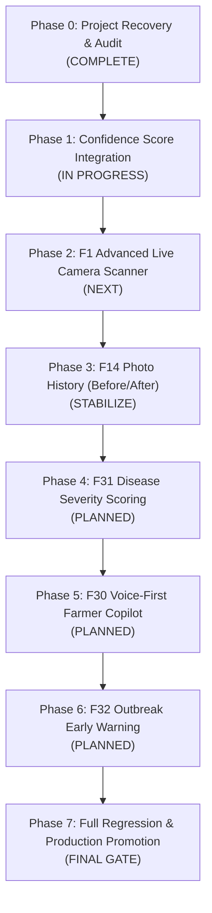

# AgroLeaf AI — Master Execution Tracker
**Document ID:** `docs/AGROLEAF_MASTER_EXECUTION_TRACKER.md`  
**Last Updated:** 2026-11-04T13:25:00+06:00  
**Project Lead & Technical Architect:** Antigravity  
**Live Production URL:** `https://agroleaf-ai.pages.dev`  
**Production Git Head:** `758ed02` (`deploy/candidate-ready` / `main`)

---

## 1. Feature Execution Status Summary

| Feature ID & Name | Category | Status | Branch / Worktree | Latest Commit / Checkpoint | Test Status | Next Action |
| :--- | :--- | :--- | :--- | :--- | :--- | :--- |
| **F1: Image Pipeline & Preprocessing** | Core AI | **Implemented & Verified** | `deploy/candidate-ready` | `69a48dd` | 13/13 unit tests pass | F1 Advanced camera upgrade |
| **F1 Advanced: Live Guided Camera Scanner** | Mobile CV | **Researched & Ready for Impl** | `deploy/candidate-ready` | Audit complete | Pending architecture impl | Build on-device live video frame analyzer |
| **F5–F7: Bangla Voice Audio Advisory** | Accessibility | **Implemented & Verified** | `deploy/candidate-ready` | `a0f865a` | 6/6 audio tests pass | Maintain offline audio cache |
| **F8 / F8 v2: Weather & Crop Disease Analysis** | Weather / BAMIS | **Implemented & Verified** | `deploy/candidate-ready` | `faa1d17` | 33/33 tests pass | Maintain Open-Meteo edge proxy |
| **F9: Progressive Web App (Offline PWA)** | Infrastructure | **Implemented & Verified** | `deploy/candidate-ready` | `758ed02` | 6/6 PWA tests pass | Model Cache v2 verified in build |
| **F10: This-Week Action Plan** | Advisory | **Implemented & Verified** | `deploy/candidate-ready` | `e4058b9` | 5/5 tests pass | Preserved chemical safety guidelines |
| **F11: Explainable AI Heatmap** | Explainable AI | **Implemented, Fixed & Verified** | `deploy/candidate-ready` | `758ed02` | 24/24 XAI tests pass | In production, visual regression verified |
| **F14: Photo History (Before/After Tracking)** | Crop Care | **Architecture Audited** | `deploy/candidate-ready` | IndexedDB schema ready | Integration tests needed | Distinguish cleanly from Confidence Score |
| **Confidence Score (Calibrated Prob)** | AI Uncertainty | **Module Built, Integrating** | `deploy/candidate-ready` | Working tree | Tests in progress | Integrate into ResultScreen |
| **F24: Farmer Reminder & Crop Care Scheduler** | Crop Care | **Implemented & Verified** | `deploy/candidate-ready` | `73787c1` | 24/24 reminder tests pass | Preserved offline IndexedDB v2 |
| **F26: Yield Impact Estimation & Risk** | Agronomy / Risk | **Implemented & Verified** | `deploy/candidate-ready` | `fb4e042` | 15/15 yield tests pass | BAMIS dynamic risk validated |
| **F30: AI-Powered Disease Q&A (Voice Copilot)**| Voice Assistant | **Requirements Recovered** | Planning phase | Design finalized | Free-only local RAG planned | Curate BRRI/DAE Q&A knowledge base |
| **F31: Disease Severity Scoring** | Quantitative AI| **Requirements Recovered** | Planning phase | Design finalized | Lesion segmentation planned | Calibrate disease-specific severity tables |
| **F32: Outbreak Early Warning & Neighbor Alert**| Community Intel | **Requirements Recovered** | Planning phase | Design finalized | Central aggregation planned | Build privacy-preserving area rollup |

---

## 2. Granular Phase-by-Phase Execution Progress

### Detailed Phase Milestones

1. **Phase 0 — Project Recovery & Grounding (Done):**
   - Fixed P0 F11 heatmap rendering failure (committed `758ed02`, pushed to `main`).
   - Verified 45 Vitest test files (330 tests passing), Oxlint (0 errors), Build (<25 MiB ceiling).
   - Audited git worktrees, branches, untracked artifacts, and previous prompts.
   - Identified and resolved the F14 vs Confidence Score nomenclature collision.

2. **Phase 1 — Confidence Score Feature (In Progress):**
   - Surface calibrated probability (`scan.decision.top.prob`) from temperature-scaled inference.
   - Badge thresholds: High ($\ge 90\%$), Medium ($70\text{--}89\%$), Low ($< 70\%$).
   - Actionable farmer prompts: Retake photo ($< 60\%$), Call 16123 helpline ($< 50\%$).
   - Complete unit tests, integrate into `ResultScreen.jsx`, verify responsive rendering on 360–412px.

3. **Phase 2 — F1 Advanced Intelligent Live Guided Camera Scanner:**
   - Real-time video frame sampling (5–10 FPS) via `navigator.mediaDevices.getUserMedia`.
   - On-device brightness (luminance histogram) & blur detection (Laplacian variance on offscreen canvas).
   - Rice leaf localization and boundary framing guide with large directional arrows.
   - Stable "Ready to Capture" state with debouncing.
   - 100% free, zero paid APIs, zero external cloud inference.

4. **Phase 3 — F14 Photo History (Before/After Tracking) Stabilization:**
   - Verify IndexedDB tracking of a specific tagged plant across multiple scan intervals.
   - Visual comparison viewer (Day 0 vs Day 3 vs Day 7 symptom progression).
   - Local-first offline persistence without server dependency.

5. **Phase 4 — F31 Disease Severity Scoring & Impact Assessment:**
   - Distinguish attention heatmap (F11) from true lesion segmentation.
   - Support Blast (0–9 IRRI Standard Evaluation System) and Brown Spot lesion area quantification.
   - Return honest abstention state for unsupported/unclear foliage.
   - Grounded action plan based on BRRI/DAE severity recommendations.

6. **Phase 5 — F30 AI-Powered Disease Q&A (Voice-First Farmer Copilot):**
   - Large prominent microphone button as the primary interaction (typing optional).
   - Free-only speech recognition (Web Speech API / on-device WASM) and Bangla speech synthesis.
   - Curated, versioned BRRI/DAE agricultural knowledge base with strict evidence-bound responses.
   - Honest abstention: "এই বিষয়ে আমার কাছে যাচাই করা তথ্য নেই।"

7. **Phase 6 — F32 Outbreak Early Warning & Neighbor Risk Alert:**
   - Privacy-preserving opt-in community surveillance.
   - Administrative area aggregation (Union/Upazila/District), zero exact farm coordinates.
   - Contributor-aware deduplication and scan-volume normalization.
   - Statistically grounded early warning signals with clear farmer-friendly Bangla advisories.

8. **Phase 7 — Full Regression, Build & Release Verification:**
   - 100% pass across all unit, integration, mobile viewport, and E2E suites.
   - Final deployment to `https://agroleaf-ai.pages.dev` with live verification.
