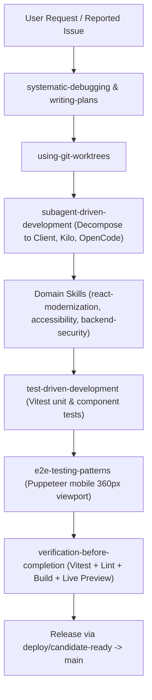

# AgroLeaf AI — Antigravity Skills Setup & Operating Guide

**Document:** `docs/ANTIGRAVITY_SKILLS_SETUP.md`  
**Location:** `.agents/skills/`  
**Lead:** Antigravity (Project Lead & Technical Architect)  
**Date:** 4 November 2026  

---

## 1. Installation Locations & Discovery

Antigravity uses a hierarchical discovery mechanism to load skills without token bloat:
1. **Workspace Location:** `<repo-root>/.agents/skills/<skill-name>/SKILL.md`
   - Active path: `D:\Desktop\AIgnite 2026\AgroLeaf_AI_AIgnite_2026\.agents\skills`
   - Synced deploy worktree path: `D:\Desktop\AIgnite 2026\AgroLeaf_deploy_wt\.agents\skills`
2. **Metadata Injection:** At session startup, Antigravity reads only the YAML frontmatter (`name` and `description`) from each `SKILL.md`.
3. **Progressive Disclosure:** Detailed instructions and playbooks in `resources/` or `references/` are read **only when invoked**.

---

## 2. Directory Layout of Installed Skills

```text
.agents/skills/
├── accessibility-compliance-accessibility-audit/
│   ├── SKILL.md
│   └── resources/
├── api-design-principles/
│   ├── SKILL.md
│   └── resources/
├── application-performance-performance-optimization/
│   ├── SKILL.md
│   └── resources/
├── backend-architect/
│   └── SKILL.md
├── backend-security-coder/
│   └── SKILL.md
├── computer-vision-expert/
│   └── SKILL.md
├── e2e-testing-patterns/
│   ├── SKILL.md
│   └── resources/
├── executing-plans/
│   └── SKILL.md
├── react-modernization/
│   ├── SKILL.md
│   └── resources/
├── subagent-driven-development/
│   └── SKILL.md
├── systematic-debugging/
│   └── SKILL.md
├── test-driven-development/
│   └── SKILL.md
├── using-git-worktrees/
│   └── SKILL.md
├── verification-before-completion/
│   └── SKILL.md
└── writing-plans/
    └── SKILL.md
```

All 15 installed skills possess valid YAML frontmatter, verified UTF-8 encoding, and adhere strictly to Antigravity skill specifications.

---

## 3. Integrating Skills into the Project Lead Workflow

As Project Lead, Antigravity applies these skills systematically across the software development lifecycle:



### Specific Role Assignments:

1. **Planning & Task Decomposition:**
   - **Skill:** `writing-plans` + `subagent-driven-development`
   - **Application:** Break complex features into small, testable modules with strict input/output contracts before delegating to Client, Kilo, or OpenCode.

2. **Isolated Worktree Safety:**
   - **Skill:** `using-git-worktrees`
   - **Application:** Work strictly in isolated worktrees (`AgroLeaf_deploy_wt`, `AgroLeaf_cline_wt`, etc.). Never develop on shared root or push untested code to `main`.

3. **Mobile-First UX & Accessibility (ISSUE-001 & ISSUE-003):**
   - **Skills:** `accessibility-compliance-accessibility-audit` + `react-modernization`
   - **Application:** Audit viewport layouts at 360px width, ensure touch targets $\ge 44 \times 44$px, natural Bengali text wrapping, and clean component state trees.

4. **Privacy, Location & Security (ISSUE-002 & ISSUE-004):**
   - **Skills:** `backend-security-coder` + `api-design-principles`
   - **Application:** Eliminate unsolicited GPS calls from the homepage. Relocate location controls entirely to the Weather tab with manual district fallback. Ensure zero unnecessary PII is stored.

5. **Release Verification:**
   - **Skill:** `verification-before-completion`
   - **Application:** Mandate `vitest run` (0 failures), `npm run lint` (0 errors), `npm run build` (all files < 25 MiB), and live preview validation before merging to production.

---

## 4. Verification & Status

- **Verification Date:** 4 November 2026
- **Test Discovery:** Passed. All 15 skill directories contain verified `SKILL.md` files.
- **Reload Requirement:** None. Workspace skills in `.agents/skills` are picked up automatically by Antigravity upon reading the directory.
- **Maintenance:** Managed under Git version control. No external package manager dependencies required at runtime.
