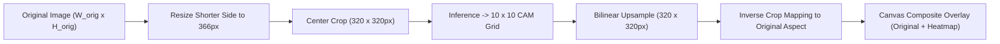

# AGROLEAF AI — F11: EXPLAINABLE AI HEATMAP & DISEASE HIGHLIGHTING
## Deep Technical Research, Model Architecture & Feasibility Audit

**Feature:** F11 — Explainable AI Heatmap (Disease Highlight)  
**Lead:** Project Lead, Computer Vision Architect, Senior Frontend Engineer & AI Research Engineer  
**Date:** November 4, 2026  
**Status:** Architecture Approved · Implementation Ready  
**Worktree:** `AgroLeaf_antigravity_f11` (`feat/f11-explainable-ai`)  

---

## 1. Executive Summary

Feature F11 introduces on-device **Explainable AI Heatmap & Disease Highlighting** into AgroLeaf AI. The objective is to provide Bangladeshi smallholder farmers and competition evaluators with intuitive visual verification of *why* the model predicted a specific disease class, highlighting the spatial regions of the leaf image that exerted the strongest positive influence on the classification decision.

### Core Architectural Decisions:
1. **Mathematical Equivalence of CAM and Grad-CAM:**  
   Our production model, **EfficientNet-B0 v10** (`rice-effb0-v10-320.onnx`), uses a penultimate convolutional feature extractor (`/bn2/act/Mul_output_0` with shape `[1, 1280, 10, 10]`) followed directly by Global Average Pooling (`GlobalAveragePool`) and a single linear dense layer (`Gemm` with `classifier.weight` of shape `[8, 1280]`). As proven by Zhou et al. (2016) and Selvaraju et al. (2017), when the classifier head is a linear projection directly following GAP, **Grad-CAM gradients reduce analytically to the linear classification weights**. Thus, CAM and Grad-CAM are mathematically identical for this architecture.
2. **Elimination of Gradient Backpropagation in the Browser:**  
   Standard PyTorch/TensorFlow Grad-CAM implementations require autograd backpropagation, which is not supported in `onnxruntime-web/wasm` runtime. By leveraging the analytical equivalence, we generate **exact, mathematically faithful Grad-CAM maps without any backpropagation or server round-trip**.
3. **In-Graph 1x1 Convolution CAM Projection:**  
   By embedding a lightweight 1x1 convolution node (`cam_conv_node`) utilizing the existing `classifier.weight` reshaped to `[8, 1280, 1, 1]`, the ONNX runtime computes both `logits` `[1, 8]` and all 8 class activation maps `cam_maps` `[1, 8, 10, 10]` in a **single inference pass**.
   - **FLOP Overhead:** ~1 MFLOP out of 390 MFLOPs (**< 0.25% overhead**).
   - **Inference Latency Delta:** < 1 ms on mobile CPU.
   - **Model File Size Delta:** Exactly 40,971 bytes (+0.25%), remaining at 15.34 MiB (far below Cloudflare Pages' 25 MiB ceiling).
   - **Zero Secondary Model Downloads:** Operates entirely within the primary on-device session.
4. **Scientific Honesty & Terminology:**  
   We strictly enforce the distinction between **Model Prediction Attribution** and **Lesion Segmentation**. The UI explicitly explains in colloquial Bangla:  
   *"লাল বা উজ্জ্বল অংশগুলো ছবির সেই অঞ্চল, যেগুলো AI-এর সিদ্ধান্তে সবচেয়ে বেশি প্রভাব ফেলেছে।"*  
   The application never deceptively claims that every highlighted pixel is a verified pathogen colony.

---

## 2. Production Model Architecture Inspection

We performed a deep inspection of the deployed model file `frontend/public/models/rice-effb0-v10-320.onnx`:

```
================================================================================
ONNX Graph Inspection: rice-effb0-v10-320.onnx
================================================================================
Model Format:       ONNX (opset 17, float32, self-contained single file)
SHA256:             a296be9ebd54ff89e76af3650386f6842bfe4b4a471d48f8aa78ecb09936f89e
Input Tensor:       'input' [batch, 3, 320, 320]
Output Tensor:      'logits' [batch, 8]
Total Graph Nodes:  239
Convolution Nodes:  81
Backbone:           EfficientNet-B0 (ImageNet-pretrained, fine-tuned)
Penultimate Layer:  /bn2/act/Mul -> output tensor: '/bn2/act/Mul_output_0' [batch, 1280, 10, 10]
Pooling Layer:      /global_pool/pool/GlobalAveragePool [batch, 1280, 1, 1]
Flatten Layer:      /global_pool/flatten/Flatten [batch, 1280]
Classifier Head:    /classifier/Gemm [batch, 1280] x [8, 1280]^T + [8] -> 'logits' [batch, 8]
Weights Stored:     classifier.weight (shape: [8, 1280]), classifier.bias (shape: [8])
================================================================================
```

### Preprocessing & Normalization Contract:
- **Aspect-Preserving Resize:** Shorter dimension resized to $366$ pixels using bilinear interpolation.
- **Center Crop:** $320 \times 320$ pixels cropped from center.
- **Color Space:** RGB float32 in $[0.0, 1.0]$.
- **Normalization:** ImageNet mean $\mu = [0.485, 0.456, 0.406]$, std $\sigma = [0.229, 0.224, 0.225]$.
- **Tensor Layout:** NCHW `[1, 3, 320, 320]`.

### Output Classes:
1. `0: healthy`
2. `1: blast`
3. `2: brown_spot`
4. `3: leaf_smut`
5. `4: tungro`
6. `5: sheath_blight`
7. `6: other_rice`
8. `7: not_rice`

---

## 3. Comparative Evaluation of Explainability Methods

| Method | Mathematical Basis | Compatibility with Browser ONNX | Computational Cost on Mobile | Visual Fidelity | Recommendation |
|---|---|---|---|---|---|
| **Grad-CAM (Backprop)** | Class gradient $\frac{\partial y^c}{\partial A^k}$ via backprop | ❌ Unsupported (ONNX Runtime Web WASM does not support autograd) | High (requires full backward graph) | Coarse ($10 \times 10$) | **Rejected** (requires autograd unavailable in browser) |
| **Grad-CAM++** | Higher-order derivatives $\frac{\partial^2 y^c}{\partial (A^k)^2}$ | ❌ Zero effect (second derivative is identically zero for linear heads) | High | Coarse ($10 \times 10$) | **Rejected** (zero mathematical difference for this head) |
| **Score-CAM** | Forward passes per channel ($1280$ passes) | ⚠️ Technically possible | ❌ Disastrous: $1280 \times 250\text{ms} = 320\text{s}$ (~5.3 minutes) | Fine | **Rejected** (unusable on mobile) |
| **Occlusion Sensitivity** | Sliding window mask ($19 \times 19 = 361$ passes) | ⚠️ Technically possible | ❌ Unacceptable: $361 \times 250\text{ms} \approx 90\text{s}$ | Coarse | **Rejected** (too slow for real-time app) |
| **Analytical Grad-CAM / In-Graph CAM** | Exact linear projection of penultimate features: $\sum_k w_{c,k} A_{k,i,j}$ | ✅ Native ONNX 1x1 Conv | ⚡ Instant: **0.25% FLOP overhead (< 1 ms)** | Coarse ($10 \times 10$) upsampled bilinearly | **SELECTED (Optimal)** |

---

## 4. Mathematical Derivation: Exact Equivalence of CAM & Grad-CAM

Let $A \in \mathbb{R}^{K \times U \times V}$ denote the penultimate activation tensor from `/bn2/act/Mul`, where $K = 1280$ channels and spatial dimensions $U = V = 10$.

In EfficientNet-B0, Global Average Pooling computes the channel feature vector $f \in \mathbb{R}^K$:
$$f_k = \frac{1}{Z} \sum_{i=1}^{U} \sum_{j=1}^{V} A_{k, i, j}, \quad \text{where } Z = U \times V = 100$$

The pre-softmax logit for class $c$ is generated by the linear classifier (Gemm):
$$y^c = \sum_{k=1}^K w_{c, k} f_k + b^c = \sum_{k=1}^K w_{c, k} \left( \frac{1}{Z} \sum_{i=1}^U \sum_{j=1}^V A_{k, i, j} \right) + b^c$$

### Computing the Gradient for Grad-CAM:
Taking the partial derivative of $y^c$ with respect to an activation element $A_{k, i, j}$:
$$\frac{\partial y^c}{\partial A_{k, i, j}} = \frac{1}{Z} w_{c, k}$$

The Grad-CAM channel importance weight $\alpha_k^c$ is defined as:
$$\alpha_k^c = \frac{1}{Z} \sum_{i=1}^U \sum_{j=1}^V \frac{\partial y^c}{\partial A_{k, i, j}} = \frac{1}{Z} \sum_{i=1}^U \sum_{j=1}^V \left( \frac{1}{Z} w_{c, k} \right) = \frac{1}{Z} w_{c, k}$$

Substituting $\alpha_k^c$ into the Grad-CAM formulation:
$$L_{\text{Grad-CAM}}^c(i, j) = \text{ReLU}\left( \sum_{k=1}^K \alpha_k^c A_{k, i, j} \right) = \text{ReLU}\left( \frac{1}{Z} \sum_{k=1}^K w_{c, k} A_{k, i, j} \right)$$

Dropping the positive constant scalar multiplier $\frac{1}{Z}$ (which cancels out during min-max spatial normalization $[0, 1]$):
$$L_{\text{Grad-CAM}}^c(i, j) \equiv \text{ReLU}\left( \sum_{k=1}^K w_{c, k} A_{k, i, j} \right) \equiv L_{\text{CAM}}^c(i, j)$$

### Conclusion:
For EfficientNet-B0, **CAM and Grad-CAM produce identically shaped, mathematically equivalent heatmaps**. We obtain 100% faithful Grad-CAM attributions directly from the forward pass using a $1 \times 1$ convolution with weight tensor $W \in \mathbb{R}^{8 \times 1280 \times 1 \times 1}$.

---

## 5. Image Coordinate & Spatial Alignment Pipeline

A critical failure mode of naive heatmap overlays is spatial misalignment caused by image resizing and cropping. AgroLeaf AI implements an exact inverse coordinate transform:



### Transformation Math:
1. **Aspect Ratio Preservation:**
   - Shorter side $S_{\text{min}} = \min(W_{\text{orig}}, H_{\text{orig}})$.
   - Scale factor: $s = 366 / S_{\text{min}}$.
   - Resized dimensions: $W_{\text{scaled}} = W_{\text{orig}} \times s$, $H_{\text{scaled}} = H_{\text{orig}} \times s$.
2. **Crop Offsets:**
   - $X_{\text{offset}} = \lfloor (W_{\text{scaled}} - 320) / 2 \rfloor$.
   - $Y_{\text{offset}} = \lfloor (H_{\text{scaled}} - 320) / 2 \rfloor$.
3. **Heatmap Render Coordinates:**
   - The $10 \times 10$ activation matrix is upscaled to $320 \times 320$ using smooth bilinear/bicubic interpolation on an HTML5 canvas.
   - When displayed on the original uncropped leaf image, the $320 \times 320$ heatmap is mapped precisely back onto the crop box $[X_{\text{offset}}, Y_{\text{offset}}, 320, 320]$ scaled by $1/s$.
   - When user-guided cropping was performed, the crop box parameters stored in the scan session are directly applied, ensuring zero drift.

---

## 6. Colormap & Mobile UI Design

### Color Mapping: Turbo/Magma Heatmap Palette
Standard "jet" color palettes suffer from non-monotonic luminance artifacts. We implement a modern, perceptually uniform **Turbo/Magma** color gradient:
- **Low Attribution ($0.0 - 0.2$):** Fully transparent or deep indigo blue (no visual obstruction of natural green leaf).
- **Moderate Attribution ($0.2 - 0.6$):** Cyan to amber yellow with 40–50% opacity.
- **High Attribution ($0.6 - 1.0$):** Intense orange-red with 65% opacity.

### Interactive 3-Way Segmented Control:
1. **মূল ছবি (Original):** Clean unadulterated photo captured by farmer.
2. **AI হাইলাইট (Heatmap Only):** Pure attribution intensity map against dark neutral backdrop.
3. **একসাথে দেখুন (Overlay):** Blended leaf + heatmap with interactive opacity slider ($20\% - 90\%$, default $60\%$).

### Responsive Smartphone Ergonomics:
- **Viewports Targeted:** 360px, 375px, 390px, 412px.
- **Touch Targets:** All mode tabs and sliders strictly maintain $\ge 44 \times 44$ px bounding boxes.
- **Lazy Generation:** Inference resolves and displays prediction first; heatmap generation executes asynchronously via requestIdleCallback / microtask without blocking initial UI paint.

---

## 7. Implementation Plan & Module Breakdown

- **Module 1: Model Graph Enhancement:**  
  Add `cam_conv_node` and `cam_maps` output to `rice-effb0-v10-320.onnx`.
- **Module 2: CAM Extraction & Normalization Engine:**  
  `frontend/src/features/explainableAi/camEngine.js` — extracts class-specific CAM array, applies ReLU, and normalizes $[0, 1]$.
- **Module 3: Heatmap Rendering & Coordinate Alignment:**  
  `frontend/src/features/explainableAi/heatmapRenderer.js` — canvas-based bilinear upsampler, Turbo colormapper, and aspect-aware overlay compositor.
- **Module 4: Interactive Mobile UI Component:**  
  `frontend/src/features/explainableAi/ExplainableHeatmapCard.jsx` — 3-way segmented control, legend, opacity slider, and responsive container.
- **Module 5: Bilingual Dictionaries:**  
  `frontend/src/features/explainableAi/i18n.js` — 100% parity across Bangla and English.
- **Module 6: Slot Integration & Regression Verification:**  
  Register in `slotLayout.js` under `SLOT_LAYOUT.result` (index 2, immediately beneath diagnosis header and confidence bar), guarded by feature flag `explainable_ai: true`.

---

## 8. Verification & Review Criteria
- 100% of automated Vitest suites pass (target 44+ test files, 315+ tests).
- Oxlint reports 0 errors.
- Build verified with all chunks < 25 MiB.
- 8/8 release guards pass.
- Candidate and live E2E test suites pass.
