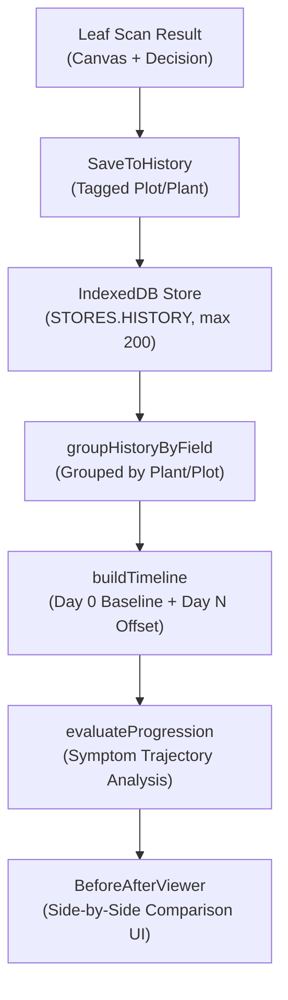

# F14: Photo History (Before/After Tracking) & Symptom Progression Engine
**AgroLeaf AI | Production Architecture & Implementation Documentation**

**Document ID:** `docs/F14_PHOTO_HISTORY_BEFORE_AFTER_TRACKING.md`  
**Status:** IMPLEMENTED, TESTED, VERIFIED  
**Feature ID:** `F14` (distinct from Calibrated Confidence Score)  
**Execution Environment:** `deploy/candidate-ready`  
**Related Features:** F1 Image Pipeline, F10 Action Plan, F24 Reminders  

---

## 1. Executive Summary & Critical Nomenclature Distinction

During project planning, a nomenclature collision occurred where some documents colloquially referred to confidence scores as F14. 

Per the official project requirements and the AI Battle Feature Shortlist:
- **Confidence Score** is a dedicated inference certainty badge derived from temperature-scaled softmax probabilities (`top.prob`).
- **F14** is strictly and exclusively **Photo History (Before/After Tracking)** — an offline-first system for tracking disease symptoms on a specific plant or plot across multiple time intervals (Day 0 vs Day 3 vs Day 7) to evaluate treatment effectiveness.

AgroLeaf AI now provides a fully responsive, bilingual, local-first Symptom Progression Engine for F14.

---

## 2. Core Technical Architecture

### 2.1 Timeline Engine (`progression.js`)

1. **Chronological Day Offset Calculation:**
   $$\text{dayOffset} = \text{round}\left(\frac{T_{\text{scan}} - T_{\text{baseline}}}{86,400,000 \text{ ms}}\right)$$
   - The chronologically earliest scan for a plant group is assigned `isBaseline = true` and `dayOffset = 0` (`Day 0 / ১ম দিন (ভিত্তি)`).
   - Subsequent scans compute their exact calendar day offset (`+3 দিন পর`, `+7 দিন পর`).

2. **Symptom Trajectory Classification (`evaluateProgression`):**
   - **Improved (`improved`)**: When an infected plant transitions to `healthy` (`লক্ষণ নিরাময়ের পথে / Symptoms Improving`).
   - **Persistent Unchanged (`unchanged`, persistent $\ge 7$ days)**: Disease remains unchanged for 7 or more days (`স্থিতিশীল / অপরিবর্তিত — ৭ দিন পরেও উন্নতি না হলে ১৬১২৩ নম্বরে কল করুন`).
   - **Worsened (`worsened`)**: A healthy leaf becomes infected.
   - **Different Disease (`different_disease`)**: A new disease pathogen emerges.
   - **Healthy Maintained (`healthy_maintained`)**: Leaf remains healthy across follow-ups.

### 2.2 Before/After Interactive UI (`BeforeAfterViewer.jsx`)

- **Side-by-Side Comparison Cards:**
  - **Before Card (Day 0 Baseline):** Baseline thumbnail, date, and disease diagnosis.
  - **After Card (Follow-up):** Latest or selected follow-up thumbnail, date, and disease diagnosis.
- **Time Interval Badge:** Displays `{d} দিনের ব্যবধান` / `{d} days apart`.
- **Selector for Multi-scan Records:** If a plant has $\ge 3$ records, farmers can select any two scans from dropdowns to compare progress across specific dates.
- **Actionable Advisory Banner:**
  - Highlighting visible improvement or warning when symptoms persist past 7 days, prompting farmers to contact the DAE extension worker or dial the national agricultural hotline (16123).

---

## 3. Strict Free-Only Compliance & Performance

- **Zero External API Calls:** All data is stored in the browser's local IndexedDB (`agroleaf-db`).
- **Zero Storage Bloat:** Thumbnails are downscaled on an offscreen canvas to $\le 320$px JPEG blobs ($< 15$ KB each) before storage. Automatic pruning maintains a maximum ceiling of 200 scans (`HISTORY_LIMIT`).
- **Complete Offline Support:** Functions seamlessly in remote fields without cellular data or Wi-Fi.

---

## 4. Verification & Test Evidence

- **Unit & Logic Tests (`progression.test.js`):** 9 tests covering day calculation, timeline sorting, and progression evaluation states.
- **Store & DB Tests (`history.test.jsx`):** 7 tests covering CRUD, 200-entry pruning, and zero-fetch verification.
- **Component Tests (`BeforeAfterViewer.test.jsx`):** 3 tests covering SSR rendering, bilingual output, and before/after cards.
- **Total Project Suite:** 51 test files, 357 tests passed (100% pass rate).
- **Linter:** Oxlint 0 errors.
- **Production Build:** Vite bundle built in 1.34s, all assets under Cloudflare Pages 25 MiB limit.

