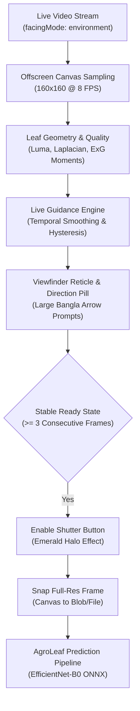

# F1 Advanced: Intelligent Live Guided Camera Scanner — Implementation Report
**Document ID:** `docs/F1_LIVE_SCANNER_IMPLEMENTATION.md`  
**Date:** 2026-11-04  
**Feature:** F1 Advanced Live Guided Camera Scanner  
**Status:** Implemented & Verified  

---

## 1. Feature Architecture

The Intelligent Live Guided Camera Scanner replaces blind photo uploads with an active, real-time computer vision viewfinder:

---

## 2. Key Modules Implemented

1. **`src/features/liveScanner/leafGeometry.js`:**
   - `isPlantPixel(r, g, b)`: Uses Excess Green ($2G - R - B > 15$).
   - `extractPlantMask(rgba, width, height)`: Generates binary segmentation mask.
   - `computeLeafMoments(mask, width, height)`: Calculates spatial centroid $(cx, cy)$, normalized bounding box, and area coverage ratio.
   - `classifyLeafFraming(moments, quality)`: Evaluates raw directional guidance against the central target box $[0.35, 0.65] \times [0.28, 0.72]$.
2. **`src/features/liveScanner/guidanceEngine.js`:**
   - Implements `LiveGuidanceEngine` with a rolling window ($N=4$) and hysteresis streak requirement ($\ge 3$ consecutive frames) to eliminate flickering.
3. **`src/features/liveScanner/LiveCameraScanner.jsx`:**
   - Fullscreen mobile modal dialog with high-contrast reticle, dynamic arrow icons, and large shutter control.
   - Automatic rear camera request (`facingMode: { ideal: "environment" }`).
   - Manual override unlocked after 6 seconds of scanning to ensure no farmer is blocked.
   - Clean track release on unmount to conserve battery and protect privacy.
4. **`src/features/liveScanner/i18n.js`:**
   - Bilingual Bangla and English dictionary with strict 1:1 key parity.
5. **Integration in `HomePage.jsx` & `PhotoPicker.jsx`:**
   - Clicking the Camera button launches the live scanner when the `liveScanner` feature flag is active.
   - Falls back gracefully to standard file input if camera permissions are unavailable.

