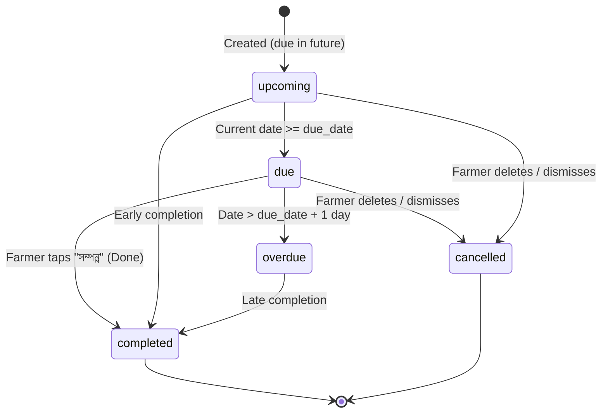

# AgroLeaf AI — F24 Farmer Reminder & Crop Care Scheduler
## Research, Technical Analysis & Architecture Design

**Document:** `docs/F24_REMINDER_RESEARCH_AND_DESIGN.md`  
**Author:** Antigravity (Project Lead & Technical Architect)  
**Date:** 4 November 2026  
**Status:** Architecture Approved & Module Specification Ready  

---

## 1. Executive Research Summary

### Context & Problem Statement
AgroLeaf AI accurately identifies rice leaf diseases (EffB0 v10, 84.4% macro-F1, on-device ONNX runtime). However, disease management is an iterative process: after taking an immediate non-chemical step (e.g. stopping excess nitrogen, improving water drainage), farmers must inspect their crops 2–5 days later to monitor disease progression and determine whether symptoms are stabilizing or spreading.

Farmers in rural Bangladesh face distinct technical realities:
- Mobile devices are predominantly Android (Transsion/Infinix/Tecno, Xiaomi/Redmi, Samsung Galaxy A).
- Aggressive OEM battery management terminates background tasks and closed browser tabs.
- Internet access is intermittent: farmers frequently turn off mobile data to save bandwidth and money.
- Many farmers instinctively deny or ignore system permission popups ("Block / Allow Notifications").
- Literacy constraints require clear pictograms, high-contrast visual cues, simple Bengali, and voice/audio readouts.

### Core Architecture Decision: Local-First Hybrid Model
We adopt an **Offline-First, Zero-Blocking Hybrid Architecture**:
1. **Local-First Storage:** Reminders are persisted in on-device IndexedDB (`agroleaf` store `reminders`). Reminders are created, scheduled, edited, and completed with 0ms network latency and work 100% offline.
2. **Prominent In-App Alerting:** On app open and route navigation, the scheduler evaluates all stored reminders. Any reminder marked `due` or `overdue` triggers a clear, farmer-friendly top banner on the home screen, an unread badge on the navigation tab, and an audio alert option.
3. **Progressive Notification Enhancement:** If the browser supports the Notification API / Service Worker registration and the user grants permission, the application issues native notifications when the reminder triggers. If permission is denied or unsupported (e.g. non-PWA iOS Safari), the application **never blocks** reminder creation and gracefully relies on in-app alerts.
4. **Honest Platform Transparency:** The UI explicitly communicates when reminders will be seen: *"অ্যাপ চালু করলে বা ব্রাউজারে নোটিফিকেশন চালু থাকলে সতর্কবার্তা পাবেন"* ("You will see alerts when opening the app or when browser notifications are enabled"). We never make false promises of exact-minute background alarms when operating systems cannot guarantee them.

---

## 2. Technical Capabilities & Platform Limitations Matrix

| Platform / Mechanism | Works Offline? | Works When App Closed? | Permission Required? | Reliability on Budget Android |
| :--- | :---: | :---: | :---: | :---: |
| **IndexedDB In-App Alerts** | **Yes (100%)** | No (only on app open) | **No** (Zero permission) | **100% Guaranteed** |
| **Active Browser Notification** | **Yes** | Yes (if tab active in bg) | Yes (`granted`) | High (until browser cleared) |
| **PWA Service Worker Local Alert** | **Yes** | Limited (if SW alive) | Yes (`granted`) | Medium (OEMs kill inactive SWs) |
| **Web Push (VAPID + PushManager)** | No (needs net) | **Yes** (woken by OS push) | Yes (`granted` + Server) | High (requires server infrastructure) |
| **HTML5 TimestampTrigger** | No | No (Non-standard Chrome trial) | N/A | **Unsupported in production** |

### Verified Limitations (Official Web Standards)
1. **Chrome / Android Service Worker Lifecycle:** Inactive service workers are terminated within 30–60 seconds of idle time. `setTimeout` and `setInterval` in service workers do not persist across device sleep or app termination.
2. **Notification Triggers API:** The W3C `TimestampTrigger` proposal was an experimental Chromium Origin Trial (Chrome 80–86) and was not adopted into the web standards. Local scheduling without push cannot guarantee wakeup while the browser is closed.
3. **iOS Safari:** Web Push and Notification APIs are supported ONLY in standalone PWA mode (added to Home Screen) on iOS 16.4+. Regular Safari tabs do not support notifications.
4. **Permission Denial Behavior:** When a user taps "Block", subsequent calls to `Notification.requestPermission()` fail immediately without showing a UI. The app must never repeatedly nag the user or halt workflow.

---

## 3. Agricultural Follow-up Guidance & Timelines

Based on Bangladesh Department of Agricultural Extension (DAE) and BRRI (Bangladesh Rice Research Institute) field manuals:

| Diagnosis / Condition | Primary Initial Action | Recommended Follow-Up Schedule | Primary Follow-Up Action |
| :--- | :--- | :---: | :--- |
| **Rice Blast (ব্লাস্ট)** | Stop excess nitrogen; maintain standing water | **৩ দিন পর (3 days)** | Check for new spindle-shaped leaf lesions |
| **Brown Spot (বাদামি দাগ)** | Potassium top-dressing; balanced watering | **৫ দিন পর (5 days)** | Inspect if circular spots are spreading to upper leaves |
| **Sheath Blight (খোল পোড়া)** | Drain excess standing water; improve aeration | **৩ দিন পর (3 days)** | Inspect leaf sheaths above waterline |
| **Tungro (টুংরো)** | Rogue infected hills; monitor green leafhopper | **৫–৭ দিন পর (5-7 days)** | Check for yellow-orange leaf discoloration |
| **Leaf Smut (লিফ স্মাট)** | Field sanitation; avoid excessive urea | **৭ দিন পর (7 days)** | Routine check on black pustule spots |
| **Healthy Leaf (সুস্থ পাতা)** | Maintain normal fertilizer & water routine | **৭ দিন পর (7 days)** | Routine weekly crop health monitoring |
| **Inconclusive / Not-Sure** | Take clear photo in daylight; consult SAAO | **১–২ দিন পর (1-2 days)** | Re-take clear leaf photo or call 16123 |

> [!NOTE]
> All follow-up recommendations are presented as **monitoring aids** for farmers, not agronomically guaranteed treatment schedules.

---

## 4. Architecture & Data Model

### A. IndexedDB Schema Upgrade (Version 2)
Database: `agroleaf` (IndexedDB)  
New Object Store: `reminders`  
Key Path: `id` (UUID v4)  

#### Reminder Record Schema
```typescript
interface Reminder {
  id: string;               // UUID v4
  title: string;            // Short Bengali title (e.g. "ব্লাস্ট রোগ পর্যবেক্ষণ")
  description: string;      // Simple description / instructions
  due_date: string;         // ISO Date "YYYY-MM-DD"
  due_time?: string;        // "HH:MM" (e.g. "09:00", default morning)
  status: 'upcoming' | 'due' | 'completed' | 'cancelled';
  disease_id?: string;      // 'blast' | 'brown_spot' | 'tungro' | 'sheath_blight' | 'leaf_smut' | 'healthy' | null
  created_at: string;       // ISO 8601 timestamp
  updated_at: string;       // ISO 8601 timestamp
  completed_at?: string;    // ISO 8601 timestamp when farmer marked done
  source: 'diagnosis' | 'manual'; // Generated from scan vs farmer manual creation
  notification_shown?: boolean; // Whether native notification was fired
}
```

#### Object Store Indexes
- `due_date`: Fast querying of due/overdue reminders for today's date.
- `status`: Fast filtering of active (`upcoming`, `due`) vs historical (`completed`, `cancelled`).
- `disease_id`: Prevents duplicate follow-ups for the same disease scan.

### B. Reminder Lifecycle States


### C. Edge Case Handling
1. **Duplicate Prevention:**
   If a farmer scans for Rice Blast twice in 10 minutes, the follow-up card detects an existing active reminder for `blast` and offers to *"বিদ্যমান স্মরণবার্তা দেখুন"* (View existing reminder) rather than creating identical duplicates.
2. **Date Boundaries & Timezones:**
   All date comparisons use local browser date (`YYYY-MM-DD` derived from local year, month, date) to prevent UTC date shift bugs around midnight (+06:00 BST).
3. **Past Dates:**
   Manual creation validates that selected date is $\ge$ today's local date.
4. **Offline Resilience:**
   All operations write to IndexedDB synchronously via transactions. Zero network dependency.

---

## 5. UI / UX Design & Accessibility (Farmer-First)

### A. Diagnosis Result Screen Integration (`SLOT_LAYOUT.result`)
- Positioned directly after the `ActionPlan` card.
- Visual prompt:
  - Header: `"📅 পরবর্তী মাঠ পর্যবেক্ষণ স্মরণবার্তা"` (Next field inspection reminder)
  - Pre-selected preset: `"৩ দিন পর (বুধবার, ৭ নভেম্বর)"` with one-tap `"স্মরণবার্তা যোগ করুন"` (Add reminder) button.
  - Option to customize date (`"তারিখ পরিবর্তন"`).
  - Dismissable with clean confirmation state (`"✓ স্মরণবার্তা সংরক্ষিত হয়েছে"`).

### B. Dedicated Reminders Tab (`#/reminders`) & Navigation
- Added to top TabBar / nav with icon `⏰` and label `"স্মরণবার্তা"` (Reminders).
- Filter tabs: `"আসন্ন ও আজকের"` (Upcoming & Today) and `"সম্পন্ন"` (Completed).
- Quick Add button: `"+ নতুন স্মরণবার্তা"` (Large 48px touch target).
- Presets:
  - 🔍 জমিতে নতুন লক্ষণ পর্যবেক্ষণ (Check new symptoms)
  - 🌿 আক্রান্ত পাতা আবার পরীক্ষা (Re-check leaf)
  - 🌾 পুরো জমি পরিদর্শন (Full field inspection)
  - 📞 কৃষি অফিসে যোগাযোগ (Call 16123 / SAAO)

### C. Homepage Due Reminders Banner (`SLOT_LAYOUT.home`)
- If any reminder has status `due` or `overdue`:
  - A friendly green alert card appears below header:
    `"⏰ আজকের করণীয়: ব্লাস্ট রোগ পর্যবেক্ষণ (৩ দিন অতিক্রান্ত) — [দেখে নিন]"`
  - High contrast, large text, thumb-friendly tap target.

---

## 6. Testing & Quality Assurance Plan

### Unit & Integration Tests (`vitest`)
1. `remindersStore.test.js`:
   - Store initialization, schema migration from DB v1 to v2.
   - Create reminder, read by ID, list active reminders.
   - Update reminder status (`upcoming` -> `completed` / `cancelled`).
   - Duplicate prevention logic.
   - Date calculations (local timezone safety, past date rejection).
2. `remindersLifecycle.test.js`:
   - Evaluate reminder statuses against current mock dates.
   - Overdue calculation, missed reminder classification.
3. `FollowUpReminder.test.jsx`:
   - Mounts under disease diagnosis with preset days.
   - One-tap creation and state toggle.
4. `RemindersPage.test.jsx`:
   - Renders upcoming list, completed list, create modal.
   - Form validation, touch targets $\ge 44$px.

### End-to-End Viewport & Functional Tests (`puppeteer-core`)
1. Create follow-up reminder from disease diagnosis scan.
2. Verify reminder is stored in IndexedDB.
3. Change system date / navigate to home screen and verify due banner displays.
4. Test manual reminder creation.
5. Test mark as completed and cancel/delete.
6. Verify layout across 360px, 375px, 390px, 412px viewports.
