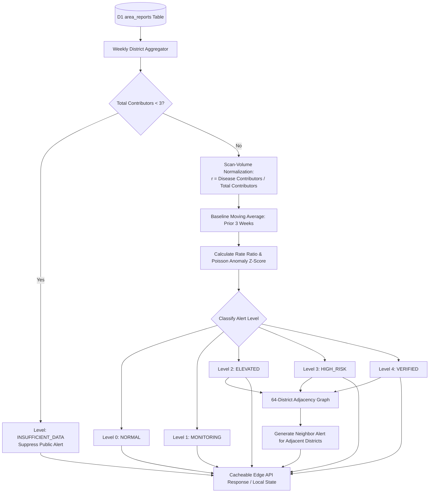

# AGROLEAF AI — F32 ALERT ENGINE DESIGN
## Mathematical Modeling, Anomaly Scoring, Adjacency Graph & Neighbor Risk Propagation Engine

**Document ID:** `F32-DES-004`  
**Feature:** F32 Outbreak Early Warning & Neighbor Risk Alert  
**Date:** November 2026  
**Status:** SPECIFICATION COMPLETE  
**Target Worktree:** `D:\Desktop\AIgnite 2026\AgroLeaf_deploy_wt`  
**Branch:** `feat/f32-outbreak-early-warning`  

---

## 1. Engine Architecture & Data Pipeline

The F32 Outbreak Signal Detection Engine operates at both the **Cloudflare Edge** (for centralized surveillance aggregation) and on the **Client PWA** (for offline-cached risk evaluation).

---

## 2. Mathematical Formulation & Statistical Anomaly Scoring

### 2.1 Variables & Definitions
- $d \in \{1, \dots, 64\}$: Administrative district code.
- $k \in \{\text{blast}, \text{brown\_spot}, \text{sheath\_blight}, \text{tungro}\}$: Target rice disease class.
- $w_0$: Current ISO calendar week (e.g., `2026-W45`).
- $W_{\text{base}} = \{w_{-1}, w_{-2}, w_{-3}\}$: Historical baseline window (preceding 3 ISO weeks).
- $N_{d,w}$: Number of unique active contributing devices in district $d$ during week $w$:
  $$N_{d,w} = |\text{DISTINCT } \text{device\_hash}_{(d,w)}|$$
- $C_{d,w,k}$: Number of unique contributing devices reporting disease $k$ in district $d$ during week $w$:
  $$C_{d,w,k} = |\text{DISTINCT } \text{device\_hash}_{(d,w,k)}|$$

### 2.2 Relative Reporting Rate ($r_{d,w,k}$)
To normalize against variations in smartphone usage and scanning frequency across regions:
$$r_{d,w,k} = \frac{C_{d,w,k}}{\max(1, N_{d,w})}$$

### 2.3 Historical Baseline Rate ($\bar{r}_{d,k}$)
$$\bar{r}_{d,k} = \frac{1}{|W_{\text{base}}|} \sum_{w \in W_{\text{base}}} r_{d,w,k}$$
If $|W_{\text{base}}| = 0$ (e.g. at the start of a season or newly active district), a national default prior rate $\bar{r}_{\text{prior}} = 0.10$ is used.

### 2.4 Rate Ratio ($\text{RR}_{d,k}$)
$$\text{RR}_{d,k} = \frac{r_{d,w_0,k}}{\max(0.05, \bar{r}_{d,k})}$$

### 2.5 Poisson-Standardized Anomaly Index ($Z_{d,k}$)
Under the null hypothesis that current disease activity matches historical baseline expectations, the expected number of disease reports is:
$$\mu_{\text{expected}} = \bar{r}_{d,k} \cdot N_{d,w_0}$$
The standardized anomaly index is:
$$Z_{d,k} = \frac{C_{d,w_0,k} - \mu_{\text{expected}}}{\sqrt{\max(1, \mu_{\text{expected}})}}$$

---

## 3. Alert Qualification Decision Table

| Level | Code | Bengali Title | English Title | Criteria | Farmer Guidance |
| :---: | :---: | :--- | :--- | :--- | :--- |
| **—** | `INSUFFICIENT_DATA` | তথ্য অপর্যাপ্ত | Insufficient Data | $N_{d,w_0} < 3$ or $C_{d,w_0,k} < 3$ | "এই এলাকায় সতর্কতা দেওয়ার মতো পর্যাপ্ত তথ্য নেই।" |
| **0** | `NORMAL` | স্বাভাবিক | Normal Activity | $Z_{d,k} < 1.0$ or $\text{RR}_{d,k} < 1.25$ | "স্বাভাবিক অবস্থা। নিয়মিত পরিচর্যা বজায় রাখুন।" |
| **1** | `MONITORING` | সতর্ক নজরদারি | Monitoring Signal | $C_{d,w_0,k} \ge 3$, $1.0 \le Z_{d,k} < 1.96$ or $1.25 \le \text{RR} < 1.75$ | "রোগের প্রাথমিক সংকেত। জমিতে নিয়মিত চোখ রাখুন।" |
| **2** | `ELEVATED` | রিপোর্ট বৃদ্ধি | Increased Reporting | $C_{d,w_0,k} \ge 3$, $Z_{d,k} \ge 1.96$ ($p < 0.05$) and $\text{RR} \ge 1.75$ | "আপনার এলাকায় রোগের রিপোর্ট বেড়েছে। পাতা পরীক্ষা করুন ও পানি ধরে রাখুন।" |
| **3** | `HIGH_RISK` | উচ্চ ঝুঁকি সংকেত | High Risk Alert | $C_{d,w_0,k} \ge 5$, $Z_{d,k} \ge 3.0$ ($p < 0.001$) and $\text{RR} \ge 2.5$ | "উচ্চ সতর্কতা! ইউরিয়া প্রয়োগ স্থগিত রাখুন এবং বালাইনাশক পরামর্শ নিন।" |
| **4** | `VERIFIED` | সরকারি নিশ্চিত | Official Advisory | Verified flag $= 1$ in database (authorized DAE/BRRI bulletin) | "কৃষি সম্প্রসারণ অধিদপ্তর কর্তৃক নিশ্চিত এলাকা সতর্কতা।" |

---

## 4. Bangladesh 64-District Adjacency Graph

To model disease transmission between neighboring regions without tracking individual movement, the engine maintains an authoritative graph of contiguous administrative district boundaries based on the Bangladesh Bureau of Statistics (BBS).

### 4.1 Adjacency Representation
Defined as an undirected graph $G = (V, E)$ where $|V| = 64$ and $(u, v) \in E$ if district $u$ and district $v$ share a terrestrial or direct river boundary.

### 4.2 Example Adjacency Mappings
- **Dhaka (1):** Gazipur (3), Narayanganj (8), Munshiganj (9), Manikganj (10), Tangail (17).
- **Mymensingh (33):** Gazipur (3), Kishoreganj (6), Jamalpur (5), Netrokona (34), Sherpur (35), Tangail (17).
- **Bogura (20):** Sirajganj (23), Gaibandha (27), Joypurhat (21), Naogaon (22), Natore (24).
- **Cumilla (52):** Brahmanbaria (51), Chandpur (53), Feni (54), Munshiganj (9), Narayanganj (8).

### 4.3 Neighbor Risk Alert Logic
For any target district $d$:
1. If district $d$ already has an alert level $\ge 2$ (`ELEVATED` or `HIGH_RISK`), its own local alert takes precedence.
2. If district $d$ is at `NORMAL` or `MONITORING`, the engine inspects all adjacent neighbors $\text{Adj}(d)$:
   $$\text{MaxNeighborLevel} = \max_{v \in \text{Adj}(d)} \text{Level}(v, k)$$
3. If $\text{MaxNeighborLevel} \ge 2$, a **Neighbor Risk Alert** is synthesized:
   - **Target District:** $d$
   - **Risk Source District:** $v^* = \arg\max_{v} \text{Level}(v, k)$
   - **Signal Message (Bengali):**
     *"আপনার পাশের এলাকা [Neighbor District Name]-এ ধানের [Disease Name] রোগের রিপোর্ট বেড়েছে। নিজের ধানক্ষেত নিয়মিত পর্যবেক্ষণ করুন।"*

---

## 5. Offline Resiliency, Freshness & Expiration Rules

1. **Timestamp Separation:**
   - `capture_time`: When the leaf photo was taken on the phone.
   - `submission_time`: When the sync request reached Cloudflare D1.
   - All statistical binning strictly uses the ISO week of `capture_time`. A sync delayed by 2 weeks enters historical baseline tables, **never triggering an artificial spike in the current week**.
2. **Alert Expiration:**
   - Alerts expire automatically at the end of the ISO week ($w_0$) unless refreshed by incoming surveillance data.
3. **Farmer Dismissal Cooldown:**
   - Farmers may dismiss an active alert banner. Dismissal is preserved in IndexedDB for 7 days unless the alert level escalates (e.g. from `ELEVATED` to `HIGH_RISK`).
