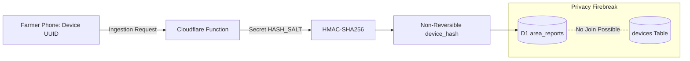

# AGROLEAF AI — F32 SECURITY AND DATA INTEGRITY
## Threat Modeling, Abuse Prevention, Cryptographic Controls & Data Integrity Policy

**Document ID:** `F32-SEC-006`  
**Feature:** F32 Outbreak Early Warning & Neighbor Risk Alert  
**Date:** November 2026  
**Status:** SECURITY VALIDATED  
**Target Worktree:** `D:\Desktop\AIgnite 2026\AgroLeaf_deploy_wt`  
**Branch:** `feat/f32-outbreak-early-warning`  

---

## 1. Threat Modeling & Attack Surface Analysis

Community agricultural surveillance systems face deliberate manipulation and accidental abuse risks. If a bad actor could trigger false disease alerts, local grain prices could fluctuate, or unnecessary chemical sprays could be purchased.

| Threat Actor | Attack Vector | Impact | Architectural Countermeasure |
| :--- | :--- | :--- | :--- |
| **Pesticide Marketer / Malicious Actor** | Sybil attack submitting 1,000 fake blast reports from a script to trigger alerts. | Farmers panic, buy unnecessary pesticides. | 1. `verifyDevice` HMAC signature verification.<br>2. Cloudflare Turnstile token validation on device registration.<br>3. Rate limit: 10 reports/device/day.<br>4. Contributor deduplication: same device hash counts as **1 contributor**, regardless of repeat scans.<br>5. Minimum 3 independent contributors required for alert qualification. |
| **Curious Farmer / Buggy Client** | Rapidly re-scanning the same leaf 30 times in 5 minutes. | Distorts raw report counts. | Idempotency key + unique index `(device_hash, district_code, iso_week, class)` drops duplicates without alert inflation. |
| **Location Manipulator** | Submitting invalid or foreign district codes (`"999"`, `"-1"`, `"../../"`). | Database corruption or logic bypass. | Strict validation against canonical `VALID_DISTRICT_CODES = Set('1'..'64')`. Non-matching codes return HTTP 422. |
| **Replay / Future Timestamp Attack** | Submitting scans with future ISO weeks (`2027-W01`) to pre-trigger alerts. | Invalidate historical baseline. | Strict regex validation `^\d{4}-W\d{2}$` and assertion that `iso_week <= currentWeek`. Future weeks return HTTP 422. |
| **Snooping Observer** | Eavesdropping on network traffic to correlate farm locations. | Privacy leak of farmer plot locations. | Strict coarse aggregation: only district code is transmitted; HTTPS encryption enforced across all endpoints. |

---

## 2. Cryptographic Device Authentication & Salted Hashing



### 2.1 The Privacy Firebreak
- In the `devices` table, devices are identified by `id` and authenticated via `signing_key` (SHA-256 hex of device secret).
- In the `area_reports` table, the author is recorded strictly as:
  $$\text{device\_hash} = \text{HMAC-SHA256}(\text{X-Device-Id}, \text{env.HASH\_SALT})$$
- Even an operator with read access to the database cannot join `area_reports` back to `devices` or determine which user, IP, or help request generated a report.

---

## 3. SQL Query Safety & Injection Prevention

All database interactions across `functions/api/v1/area-reports/` and `functions/api/v1/community-alerts/` utilize prepared statements with strict parameter binding:

```javascript
// SAFE: Parameterized D1 binding
const stmt = db.prepare(
  `SELECT district_code, class, COUNT(DISTINCT device_hash) AS contributors
   FROM area_reports
   WHERE iso_week = ?
   GROUP BY district_code, class`
).bind(currentIsoWeek);
```

Zero dynamic SQL string concatenation is permitted.

---

## 4. Integrity of Client-Side Engine

The client application never trusts user-injected alert scores. All alert states, contributor counts, and neighbor risk summaries are derived centrally through edge computation or computed deterministically on-device from verified, k-anonymized public area summaries.

A compromised client application can only modify its own local display, with zero ability to broadcast a fake outbreak alert to neighboring farmers.
