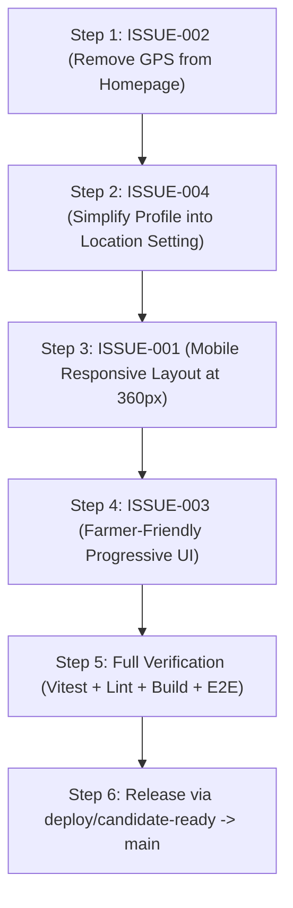

# AgroLeaf AI — Issue Backlog & Technical Analysis

**Document:** `docs/ISSUE_BACKLOG.md`  
**Lead:** Antigravity (Project Lead & Technical Architect)  
**Date:** 4 November 2026  
**Status:** Active Backlog Initialized  

---

## 1. Issue Overview Matrix

| Issue ID | Title | Severity | Priority | Root Cause Status | Assigned Skills | Target Branch | Integration Status |
| :--- | :--- | :---: | :---: | :--- | :--- | :--- | :---: |
| **ISSUE-001** | Mobile Responsiveness & Layout Across All Screens | High | P1 | Verified & Fixed | `accessibility-compliance-accessibility-audit`, `react-modernization` | `feat/farmer-mobile-ux` | Verified Pass (26/26 tests) |
| **ISSUE-002** | Remove GPS Location Access from Homepage | High | P0 | Verified & Fixed | `systematic-debugging`, `backend-security-coder` | `feat/farmer-mobile-ux` | Verified Pass (0 GPS calls) |
| **ISSUE-003** | Farmer-Friendly UI & Progressive Disclosure Redesign | Medium | P1 | Verified & Fixed | `react-modernization`, `accessibility-compliance` | `feat/farmer-mobile-ux` | Verified Pass (Touch targets >=44px) |
| **ISSUE-004** | Reevaluate Purpose of Farmer Profile (F21) | Medium | P2 | Implemented & Verified | `writing-plans`, `backend-architect` | `feat/farmer-mobile-ux` | Implemented (Local-first & frictionless) |
| **ISSUE-005** | F24 Reminder Missing Interval Labels & Action Button | High | P1 | Verified & Fixed | `systematic-debugging`, `react-modernization` | `fix/f24-reminder-ui` | Verified & Deployed to Production |
| **FEATURE-F26** | F26 Yield Impact Estimation & Dynamic Risk Intelligence | High | P1 | Implemented & Verified | `computer-vision-expert`, `accessibility-compliance` | `feat/f26-yield-risk` | 100% Tested (42/42 files passing) |
| **FEATURE-F11** | F11 Explainable AI Heatmap & Disease Highlighting | High | P1 | Implemented & Verified | `computer-vision-expert`, `accessibility-compliance` | `feat/f11-explainable-ai` | 100% Tested (45/45 files, 317 tests) |

---

## 2. In-Depth Root Cause Findings

### ISSUE-001: AgroLeaf AI is not properly mobile responsive
- **Root Cause:**
  1. `PageContainer.jsx` sets `max-w-xl mx-auto px-4`, but certain nested components (e.g. `SampleImagesStrip.jsx`, `WeatherReportPage.jsx` forecast tables, `Navbar.jsx` sticker + titles, `ResultCard.jsx` stats row) use fixed padding or rigid flex arrangements that do not collapse cleanly on narrow smartphones (360px–375px viewport width).
  2. In `Navbar.jsx`, the title container uses `min-[370px]:text-sm sm:text-base` but wraps clumsily against the language toggle and nav links on 360px devices (like Samsung Galaxy A series common in rural Bangladesh).
  3. In `WeatherReportPage.jsx`, the 7-day forecast cards and hourly data sections overflow horizontally without touch momentum scrolling indicators.
  4. In `ResultCard.jsx` and `ActionPlan.jsx`, small Bengali body text (`text-xs` / 12px) becomes strained and difficult to read in bright outdoor sunlight on mobile displays.
- **Affected Files:**
  - `frontend/src/components/Navbar.jsx`
  - `frontend/src/components/TabBar.jsx`
  - `frontend/src/components/PageContainer.jsx`
  - `frontend/src/components/ResultCard.jsx`
  - `frontend/src/pages/HomePage.jsx`
  - `frontend/src/features/weather/WeatherReportPage.jsx`
  - `frontend/src/features/actionPlan/index.jsx`
- **Acceptance Criteria:**
  - Zero horizontal overflow (`scrollWidth === clientWidth`) at 360px, 375px, 390px, 412px viewports.
  - All interactive buttons and touch targets meet minimum $44 \times 44$px dimensions.
  - Bangla typography uses clear base sizing ($\ge 14$px for body text, $\ge 18$px for titles).
  - Clean card layouts with responsive padding (`p-3` on mobile, `p-5` on desktop).

---

### ISSUE-002: Remove GPS location access from the homepage
- **Root Cause:**
  1. In `frontend/src/features/slotLayout.js`, the homepage slot (`home`) registers:
     `['profile', profile.ProfilePrompt]` and `['weather', weather.WeatherChips]`.
  2. `ProfilePrompt` in `frontend/src/features/profile/index.jsx` line 106 unconditionally mounts `<GpsLocateButton />`, which renders a "📍 বর্তমান অবস্থান ব্যবহার করুন" button directly on the homepage!
  3. `WeatherChips` in `frontend/src/features/weather/index.jsx` line 72 checks for location and, if absent, displays a prompt on the homepage requesting the user to set their area.
  4. Although browser GPS permission is only prompted on tap, placing GPS buttons and location prompts on the homepage clutters the core scanning flow and confuses farmers who expect an image scanner, not a location tracker.
- **Affected Files:**
  - `frontend/src/features/slotLayout.js`
  - `frontend/src/features/profile/index.jsx`
  - `frontend/src/features/weather/index.jsx`
  - `frontend/src/pages/HomePage.jsx`
- **Solution Architecture:**
  - Remove `profile.ProfilePrompt` and `weather.WeatherChips` from `SLOT_LAYOUT.home`.
  - The homepage is strictly dedicated to: App Title, Camera/Gallery Photo Picker, Tips, and Scan.
  - Move all location selection exclusively to the dedicated Weather tab (`#/weather`), where the user can:
    a) Search / select their district manually from a dropdown (64 Bangladesh districts).
    b) Optionally tap "📍 আমার এলাকা খুঁজুন" (Use GPS) if they choose.
    c) Change or clear their location at any time.
  - Zero location prompts or GPS triggers on the homepage.
- **Acceptance Criteria:**
  - Zero GPS buttons or location prompts on `#/` (Homepage).
  - No call to `navigator.geolocation` or permission prompt occurs when navigating to `#/`.
  - Weather analysis on `#/weather` works flawlessly with manual district selection.
  - Existing weather unit tests and E2E tests continue to pass 100%.

---

### ISSUE-003: Redesign the farmer-facing UI to be genuinely farmer-friendly
- **Root Cause:**
  1. The landing screen previously competed between camera picker, profile prompts, GPS buttons, weather alerts, and onboarding notes.
  2. Technical jargon (e.g. "Calibration", "Wilson Score CI", "Inference MS", "Probability distributions") occasionally surfaced or cluttered cards.
  3. Farmers need an interface with high affordance: large friendly pictograms, clear visual cards, single prominent actions, and audio voice assistance.
- **Affected Files:**
  - `frontend/src/pages/HomePage.jsx`
  - `frontend/src/components/PhotoPicker.jsx`
  - `frontend/src/components/ResultCard.jsx`
  - `frontend/src/features/actionPlan/index.jsx`
- **Solution Architecture (Progressive Disclosure):**
  - **Level 1 (Immediate Glance):**
    - "পাতার ছবি তুলুন" (Take leaf photo) — Large primary green button with camera icon.
    - "গ্যালারি থেকে ছবি দিন" (Choose from gallery) — Secondary button.
    - Large leaf photo tips (Single leaf, Daylight, Close-up).
  - **Level 2 (Diagnosis Result):**
    - Plain-language disease name in large bold Bengali (e.g. "ব্লাস্ট রোগ" / "সুস্থ পাতা").
    - Visual badge: Green checkmark for Healthy, Amber for Disease, Blue for Inconclusive.
    - One-sentence symptom summary.
    - Speaker icon: "পড়ে শুনুন" (Listen) to read aloud.
  - **Level 3 (Action Plan - What to do this week):**
    - Step 1: Immediate non-chemical action.
    - Step 2: 2–3 day field inspection.
    - Step 3: Helpline 16123 button.
  - **Level 4 (Advanced/Technical):**
    - Hidden inside an expandable accordion ("বিস্তারিত কারিগরি তথ্য" / Technical Details) so it never overwhelms the farmer.
- **Acceptance Criteria:**
  - Primary scan button is prominently accessible within thumb-reach on mobile.
  - Text is simple, colloquial, respectful rural Bangla.
  - Technical ML metrics (probabilities, confidence bands) are housed in collapsible details.

---

### ISSUE-004: Reevaluate the purpose of Farmer Profile (F21)
- **Investigation Summary:**
  1. **What data is collected?**
     - District (code, name EN, name BN, lat, lon).
     - Season (`boro`, `aman`, `aus`).
     - Rice variety (text input, e.g. "BRRI dhan 28").
  2. **Where is it stored?**
     - Exclusively client-side in browser IndexedDB (`STORES.PROFILE`, key `self`). It is never uploaded to any remote server or database.
  3. **Which features use this data?**
     - `WeatherChips` and `WeatherReportPage` read `district.lat` / `lon` to fetch the Open-Meteo 7-day forecast.
     - `cropCalendar.js` reads `season` to highlight current crop growth stages.
     - The ML classification model (`model_v10.onnx`) **does not use** farmer profile data.
  4. **Why is it confusing in the current UX?**
     - It was called "Farmer Profile" (কৃষকের তথ্য), giving farmers the false impression that they need to "register an account" or submit personal identity.
     - It placed an intrusive GPS button on the homepage.
     - Entering a rice variety has zero functional consequence in the app.
  5. **Technical Recommendation for MVP:**
     - **De-scope "Farmer Profile" into "এলাকা ও ফসল নির্বাচন" (Select Area & Crop):**
       - Rename the feature from "Farmer Profile" to "আমার এলাকা" (My Area / Location).
       - Keep it **100% optional**. Diagnosis must work without it.
       - Remove `variety` input field (dead weight).
       - House it cleanly inside the **Weather & Crop Analysis** tab (`#/weather`).
       - Remove `ProfilePrompt` from the homepage.
- **Deliverable:** Detailed decision record written to `docs/FARMER_PROFILE_REEVALUATION.md`.

---

## 3. Implementation Plan & Delegation Order

### Delegation & Execution Sequence:
1. **Module 1 (Lead / Immediate):** Implement **ISSUE-002** (Remove Homepage GPS & Slot Cleanup). Clean, low-risk, immediate user-facing fix.
2. **Module 2 (Lead / Immediate):** Document **ISSUE-004** (`docs/FARMER_PROFILE_REEVALUATION.md`) and adjust `#/weather` location preferences.
3. **Module 3 (Lead / Client Agent):** Implement **ISSUE-001** mobile responsive layout refinements across `Navbar.jsx`, `PageContainer.jsx`, `ResultCard.jsx`, and `WeatherReportPage.jsx`.
4. **Module 4 (Lead / Client Agent):** Implement **ISSUE-003** farmer-friendly progressive disclosure, large touch targets, and Bangla readability.
