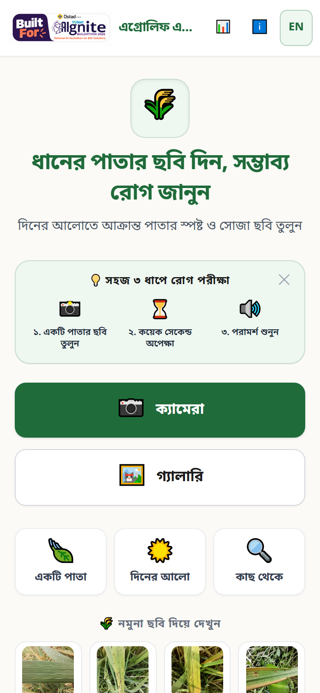
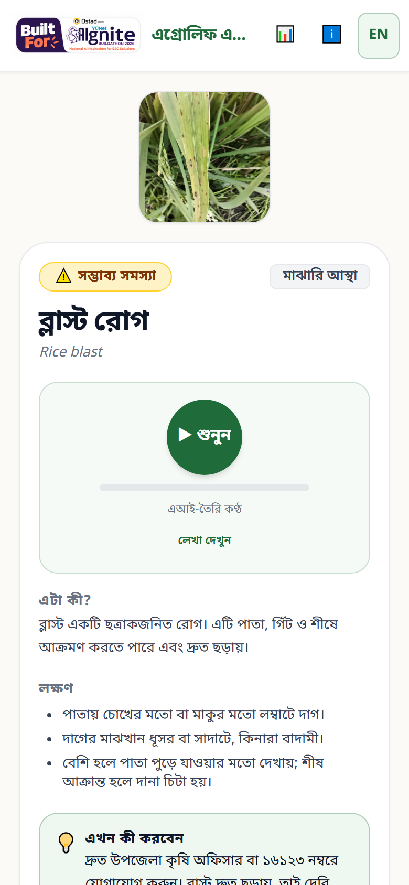
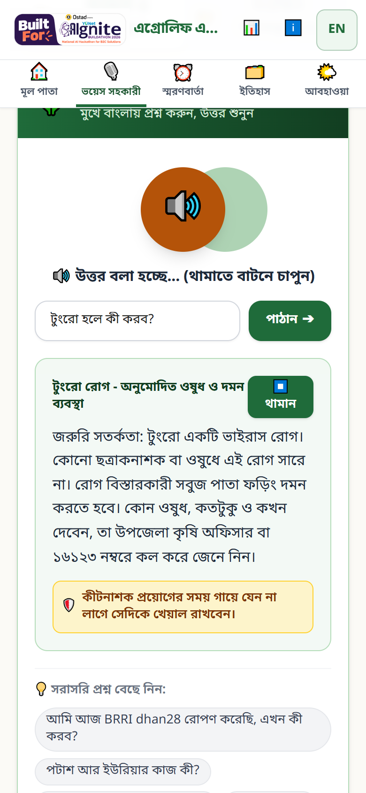

# এগ্রোলিফ এআই (AgroLeaf AI) — সম্পূর্ণ ফিচার ও ব্যবহার নির্দেশিকা

লাইভ: https://agroleaf-ai.pages.dev · কোড: https://github.com/masumcit44/AgroLeaf-AI
সংস্করণ: production `main` @ `0f9cfb8` (৫ নভেম্বর ২০২৬ রিলিজ)

**সূচিপত্র**
1. [প্রকল্প পরিচিতি](#১-প্রকল্প-পরিচিতি)
2. [ন্যাভিগেশন গাইড](#২-ন্যাভিগেশন-গাইড)
3. [সক্রিয় ফিচারসমূহ](#৩-সক্রিয়-ফিচারসমূহ)
4. [ধাপে ধাপে টিউটোরিয়াল](#৪-ধাপে-ধাপে-টিউটোরিয়াল)
5. [সীমাবদ্ধতা ও সমস্যা সমাধান](#৫-সীমাবদ্ধতা-ও-সমস্যা-সমাধান)
6. [বন্ধ রাখা (Deferred) ফিচার](#৬-বন্ধ-রাখা-deferred-ফিচার)
7. [টেকনিক্যাল রেফারেন্স](#৭-টেকনিক্যাল-রেফারেন্স)
8. [যাচাইয়ের অবস্থা](#৮-যাচাইয়ের-অবস্থা)

---

## ১. প্রকল্প পরিচিতি
**এগ্রোলিফ এআই কী?** এটি বাংলাদেশের ধানচাষিদের জন্য একটি ওয়েব অ্যাপ (মোবাইলের ব্রাউজারে চলে)। এটি ধানের অসুস্থ পাতার ছবি দেখে সম্ভাব্য রোগ বলে দেয়।

**কোন সমস্যার সমাধান?**
- ধানের রোগ (যেমন ব্লাস্ট) কয়েক দিনেই ছড়িয়ে পড়ে।
- কৃষক অনেক সময় সময়মতো কৃষি অফিসারকে পাতা দেখাতে পারেন না।
- ভুল অনুমানের ফলে ভুল ওষুধ কেনা হয়।

**কাদের জন্য?** বাংলাদেশের ক্ষুদ্র ধানচাষি এবং তাঁদের সহায়তাকারী কৃষি কর্মীরা।

**মূল যাত্রাপথ:** অ্যাপ খুলুন → পাতার ছবি তুলুন → ফলাফল দেখুন → বাংলায় পড়ুন বা শুনুন → করণীয় জানুন → ইতিহাসে সংরক্ষণ করুন → স্মরণবার্তা দিন।

---

## ২. ন্যাভিগেশন গাইড
**উপরের হেডার:**
- বাঁয়ে বিল্ডাথন স্টিকার ও অ্যাপের নাম।
- 📊 — *নির্ভুলতা* পাতা (মডেল কতটা সঠিক, পরীক্ষার ফল)।
- ℹ️ — *পরিচিতি* ও লাইসেন্স।
- **EN / বাংলা** — ভাষা বদলান।

**ট্যাব (৫টি):**

| ট্যাব | কাজ |
|---|---|
| 🏠 মূল পাতা | ছবি তোলা বা স্ক্যান, আবহাওয়া সতর্কতা, জেলা ও GPS, নমুনা ছবি |
| 🎙️ ভয়েস সহকারী | কথা বলে বা লিখে প্রশ্ন করা, উত্তর শোনা, পরিকল্পনা |
| ⏰ স্মরণবার্তা | জমি আবার দেখার রিমাইন্ডার |
| 🗂️ ইতিহাস | সংরক্ষিত স্ক্যান |
| 🌤️ আবহাওয়া | আপনার এলাকার আবহাওয়া ও রোগ-ঝুঁকি রিপোর্ট |

**প্রোফাইল:** আলাদা ট্যাব নেই। মূল পাতায় জেলার নামের পাশে "**এডিট করুন**" চাপলে প্রোফাইল খোলে।

---

## ৩. সক্রিয় ফিচারসমূহ

### ৩.১ কৃষক প্রোফাইল ও GPS অবস্থান
- **উদ্দেশ্য:** আপনার এলাকার আবহাওয়া দেখানো।
- **কোথায় পাবেন:** মূল পাতা → "এডিট করুন", অথবা "📍 আমার অবস্থান (GPS) ব্যবহার করুন"।
- **ব্যবহার:**
  1. 📍 বাটন চাপুন।
  2. ব্রাউজার অনুমতি চাইলে "Allow" দিন।
  3. অথবা প্রোফাইলে গিয়ে জেলা খুঁজে বেছে নিন, মৌসুম দিন (ঐচ্ছিক), তারপর সংরক্ষণ করুন।
- **ফলাফল:** মূল পাতায় যেমন "ঢাকা (GPS)" দেখায়। আবহাওয়া হয় আপনার আসল অবস্থানের (প্রায় ১ কিমি নির্ভুলতায়)।
- **সতর্কতা:** অবস্থান শুধু ফোনেই থাকে, ২ দশমিক পর্যন্ত গোল করে রাখা হয়। GPS দুর্বল হলে "আনুমানিক" লেখা আসে। অনুমতি না দিলে নিজে জেলা বেছে নিন।

### ৩.২ ধানের পাতা স্ক্যান (ক্যামেরা / গ্যালারি)
- **কোথায় পাবেন:** মূল পাতা → **ক্যামেরা** বা **গ্যালারি**। চেষ্টা করে দেখতে চাইলে "নমুনা ছবি দিয়ে দেখুন"।
- **যা লাগবে:** একটি পাতার কাছ থেকে তোলা, দিনের আলোয় পরিষ্কার ছবি (টিপস: একটি পাতা · দিনের আলো · কাছ থেকে)।
- **ব্যবহার:**
  1. ছবি তুলুন বা বেছে নিন।
  2. প্রিভিউ দেখুন। চাইলে আক্রান্ত অংশটুকু বেছে নিন (ক্রপ)।
  3. "**পাতা পরীক্ষা করুন**" চাপুন।
- **সতর্কতা:** ছবি অন্ধকার বা ঝাপসা হলে পরামর্শ দেখায়, তবে আটকায় না।

### ৩.৩ এআই রোগ নির্ণয় ও নির্ভরযোগ্যতা
- **কাজ:** ফোনের ভেতরে চলা মডেল ছবির রোগ চিহ্নিত করে। চেনা অবস্থা: ব্লাস্ট, বাদামী দাগ, খোল পোড়া, টুংরো, সুস্থ পাতা।
- **ফলাফল:** রোগের নাম এবং একটি **নির্ভরযোগ্যতা** ব্যাজ।
  - "উচ্চ নির্ভরযোগ্যতা" বা "মাঝারি নির্ভরযোগ্যতা"।
  - সাথে লেখা থাকে, যেমন "পরীক্ষায় এমন ফলাফলের ১০০ টির মধ্যে ৮০ টি সঠিক ছিল"।
- **"নিশ্চিত নই" ফলাফল:** মডেল নিশ্চিত না হলে অনুমান না করে "নিশ্চিত নই" বলে। কারণও দেখায়: পাতা মনে হচ্ছে না / অন্য কোনো সমস্যা / আস্থা কম। সাথে আবার ছবি তোলার পরামর্শ দেয়।
- **ব্যাখ্যা:** উচ্চ মানে বেশি ভরসা। মাঝারি হলে জমিতে মিলিয়ে দেখুন। নিশ্চিত নই হলে আবার ছবি তুলুন বা কৃষি অফিসারকে দেখান।

### ৩.৪ বাংলা ফলাফল ও কণ্ঠে শোনা (▶ শুনুন)
- **কোথায় পাবেন:** ফলাফল পাতা।
- **ব্যবহার:** ▶ **শুনুন** চাপলে আগে থেকে রেকর্ড করা বাংলা কণ্ঠে ব্যাখ্যা বাজে। "লেখা দেখুন" চাপলে কণ্ঠের লেখা দেখায়।
- **অংশগুলো:** এটা কী?, লক্ষণ, সরকারি পরামর্শ দেখুন (BAMIS/DAE)।
- **সতর্কতা:** এটি এআই-তৈরি কণ্ঠ (লেবেল দেওয়া আছে)। এটি প্রাথমিক ধারণা, চূড়ান্ত রোগ নির্ণয় নয়।

### ৩.৫ এই সপ্তাহের করণীয় পরিকল্পনা ও নিরাপত্তা
- **কোথায় পাবেন:** ফলাফল পাতা → "এই সপ্তাহের করণীয় পরিকল্পনা"।
- **কাজ:** অল্প কয়েকটি ধাপে জরুরি কাজ, জমি আবার দেখা আর প্রতিরোধ। প্রতিটি ধাপের পাশে উৎস লেখা থাকে।
- **"কীটনাশক কেনার আগে যাচাই করুন":** নিবন্ধিত ডিলার, বাংলা লেবেল, রেজিস্ট্রেশন নম্বর, মেয়াদ, আর ভেজাল সন্দেহ হলে কী করবেন।
- **নিয়ম:** অ্যাপ কখনো কীটনাশকের নাম বা মাত্রা বলে না। ওষুধের সিদ্ধান্তের জন্য উপজেলা কৃষি অফিসার বা ১৬১২৩।

### ৩.৬ সাহায্য: 🆘 সাহায্য পান ও 📞 ১৬১২৩
- **কোথায় পাবেন:** ফলাফল পাতা।
- **ব্যবহার:** "সাহায্য পান" চাপলে একটি শিট খোলে। তাতে থাকে:
  - ১৬১২৩-এ কলের বাটন (কল চার্জ প্রযোজ্য হতে পারে);
  - কেস সারাংশ: ছবি, রোগের নাম, তারিখ, জেলা।
- **কাজ:** "সারাংশ শেয়ার করুন" বা "চিত্র ডাউনলোড করুন" দিয়ে সারাংশটি কৃষি কর্মকর্তাকে পাঠাতে পারেন।

### ৩.৭ ইতিহাসে সংরক্ষণ (🗂️ ইতিহাস)
- **ব্যবহার:** ফলাফল পাতায় খেতের নাম লিখুন (ঐচ্ছিক) → "আমার ইতিহাসে সংরক্ষণ করুন" → 🗂️ ইতিহাস ট্যাবে খুলুন।
- **ফলাফল:** খেত অনুযায়ী সাজানো তালিকা, নতুনটি আগে। একটি বা সব মুছতে পারবেন।
- **সতর্কতা:** তথ্য শুধু এই ফোনের ব্রাউজারে থাকে। ব্রাউজারের ডেটা মুছলে ইতিহাসও মুছে যায়।

### ৩.৮ স্মরণবার্তা (⏰)
- **ব্যবহার:** ফলাফল পাতায় পরবর্তী মাঠ পর্যবেক্ষণের স্মরণবার্তা দিন। ⏰ ট্যাবে সব দেখুন।
- **ফলাফল:** সময় হলে মূল পাতায় ব্যানারে দেখায়। এটি ফোনেই সংরক্ষিত থাকে।
- **সতর্কতা:** অ্যাপ খুললে স্মরণবার্তা দেখায়। অ্যাপ বন্ধ থাকলে ফোনের নোটিফিকেশন আসে কি না, তা যাচাই হয়নি (NOT VERIFIED)।

### ৩.৯ ভয়েস সহকারী (🎙️) — প্রশ্ন করা ও উত্তর শোনা
- **ব্যবহার:**
  1. 🎙️ ট্যাব খুলুন।
  2. প্রশ্ন দিন:
     - **লিখে:** ঘরে লিখুন (বাংলা বা Banglish, যেমন "amar dhane blast") → **পাঠান**।
     - **কথা বলে:** মাইকে চাপ দিয়ে বলুন। লেখা ছোট বা অস্পষ্ট হলে (যেমন শুধু "আম") অ্যাপ নিশ্চিত হতে আবার জিজ্ঞেস করে।
     - **বাছাই করে:** নিচের "সরাসরি প্রশ্ন বেছে নিন" থেকে একটি চাপুন।
  3. উত্তর দেখাবে, আর 🔊 **শুনুন** / ⏹️ **থামান** দিয়ে শোনা বা থামানো যায়।
- **রেকর্ড করা উত্তর:** সাধারণ (নির্দিষ্ট) ১২২টি উত্তর আগে থেকে বাংলা কণ্ঠে রেকর্ড করা। এগুলো যেকোনো ফোনে আসল বাংলা কণ্ঠে বাজে, আর একবার শোনার পর অফলাইনেও।
- **পরিকল্পনাকারী ("গবেষণা ও পরিকল্পনা"):** "সম্পূর্ণ পরিকল্পনা", "সময়সূচি", "সার হিসাব" ধরনের প্রশ্নে ধাপে ধাপে চাষ পরিকল্পনা দেয়, যা সংরক্ষণও করা যায় ("সংরক্ষিত পরিকল্পনা")।
- **সীমাবদ্ধতা:**
  - পরিকল্পনার লেখা তাৎক্ষণিক তৈরি হয়, তাই রেকর্ড করা থাকে না। ফোনে বাংলা কণ্ঠ থাকলে তবেই শোনায়; না থাকলে "বাংলা কণ্ঠ নেই" বার্তা দেখায়। কখনো ইংরেজি কণ্ঠে পড়ে না।
  - শুধু ধান বিষয়ে উত্তর দেয়। অন্য ফসলে ১৬১২৩-এ যেতে বলে।

### ৩.১০ আবহাওয়া ও রোগ-ঝুঁকি (🌤️)
- **ব্যবহার:** 🌤️ ট্যাব খুলুন → GPS বা অনুসন্ধানে এলাকা বেছে নিন → রিপোর্ট দেখুন।
- **রিপোর্টে যা থাকে:** এখনকার আবহাওয়া, ৭ দিনের পূর্বাভাস, গত ৭ দিন, মৌসুম, কোন রোগের অনুকূল আবহাওয়া (BAMIS নিয়ম), করণীয়, উৎস ও সীমাবদ্ধতা।
- **মূল পাতায়:** ঝুঁকি থাকলে হলুদ সতর্কতা দেখায়।
- **সতর্কতা:** এটি শুধু আবহাওয়ার ঝুঁকি, রোগ নির্ণয় নয়। তথ্য Open-Meteo-র (প্রায় ১১ কিমি গ্রিড)। ইন্টারনেট লাগে।

### ৩.১১ অফলাইন ব্যবহার ও ইনস্টল
- **কাজ:** একবার অনলাইনে খুললে মডেল ফোনে থেকে যায়। এরপর ইন্টারনেট ছাড়াই গ্যালারির ছবি পরীক্ষা করা যায়, আর আগে শোনা কণ্ঠও আবার শোনা যায়।
- **ইনস্টল:** মূল পাতায় ইনস্টলের প্রস্তাব এলে হোম স্ক্রিনে যোগ করতে পারেন। নতুন সংস্করণ এলে "রিলোড করুন" বার্তা আসে।

---

## ৪. ধাপে ধাপে টিউটোরিয়াল

**ক) পাতা স্ক্যান থেকে করণীয় পর্যন্ত**
1. মূল পাতা খুলুন → **ক্যামেরা** চাপুন।
2. একটি আক্রান্ত পাতা দিনের আলোয় কাছ থেকে তুলুন।
3. চাইলে আক্রান্ত অংশটুকু বেছে নিন → **পাতা পরীক্ষা করুন**।
4. রোগের নাম ও নির্ভরযোগ্যতা দেখুন → ▶ **শুনুন**।
5. "এই সপ্তাহের করণীয়" পড়ুন। দরকার হলে 📞 ১৬১২৩।

**খ) ফলাফল বোঝা**
- **উচ্চ নির্ভরযোগ্যতা:** পরামর্শ মেনে চলুন।
- **মাঝারি:** জমির অন্য গাছেও লক্ষণ মিলিয়ে দেখুন।
- **নিশ্চিত নই:** আবার পরিষ্কার ছবি তুলুন, না হলে অফিসারকে দেখান।

**গ) প্রশ্ন করে উত্তর শোনা**
1. 🎙️ ট্যাব খুলুন।
2. লিখুন "টুংরো হলে কী করব?" → **পাঠান**।
3. 🔊 **শুনুন** চাপুন (থামাতে ⏹️ **থামান**)।

**ঘ) সংরক্ষণ ও পরে দেখা**
1. ফলাফলে খেতের নাম লিখুন → **আমার ইতিহাসে সংরক্ষণ করুন**।
2. পরে 🗂️ **ইতিহাস** ট্যাবে খুলুন।

**ঙ) স্মরণবার্তা**
1. ফলাফলে মাঠ পর্যবেক্ষণের স্মরণবার্তা দিন।
2. ⏰ ট্যাবে তালিকা দেখুন।
3. সময় হলে মূল পাতায় ব্যানার দেখায়।

**চ) অফলাইন**
1. প্রথমবার ইন্টারনেট থাকা অবস্থায় একটি স্ক্যান করুন।
2. পরে ইন্টারনেট ছাড়া অ্যাপ খুলুন → গ্যালারির ছবি পরীক্ষা করুন।

---

## ৫. সীমাবদ্ধতা ও সমস্যা সমাধান
- **কোন রোগ চেনে:** ব্লাস্ট, বাদামী দাগ, খোল পোড়া, টুংরো, সুস্থ পাতা।
  - লিফ স্মাটের নাম বলে না।
  - ব্যাকটেরিয়াল ব্লাইট, হিস্পা ইত্যাদিকে "অন্য কোনো সমস্যা" বলে।
  - পাতা ছাড়া অন্য ছবিকে "পাতা মনে হচ্ছে না" বলে।
- **নির্ভুলতা:** নির্দিষ্ট পরীক্ষায় ৮০–৮৭%। কিন্তু অন্য অঞ্চলের মাঠের ছবিতে কম (Sylhet–Dhaka সেটে ৪৪.৪%)। তাই অনিশ্চিত হলে অ্যাপ বেশি "নিশ্চিত নই" বলে। পুরো তথ্য 📊 নির্ভুলতা পাতায় আছে।
- **বাংলা কণ্ঠ:**
  - ফলাফলের কণ্ঠ ও ১২২টি নির্দিষ্ট উত্তর রেকর্ড করা, তাই সব ফোনে বাজে।
  - পরিকল্পনাকারীর লেখা শুধু ফোনে বাংলা কণ্ঠ থাকলে শোনায়। Android-এ যোগ করতে: সেটিংস → ভাষা ও ইনপুট → টেক্সট-টু-স্পিচ → Google → বাংলা।
- **ইন্টারনেট লাগে:** প্রথমবার খোলা, নমুনা ছবি, আবহাওয়া, আর যে উত্তরের কণ্ঠ আগে শোনা হয়নি।
- **ক্যামেরা কাজ না করলে:** ব্রাউজারকে ক্যামেরার অনুমতি দিন (সাইট সেটিংস), অথবা **গ্যালারি** দিয়ে ছবি দিন।
- **মাইক কাজ না করলে:** মাইকের অনুমতি দিন, অথবা লিখে প্রশ্ন করুন। (ভয়েস ইনপুট ব্রাউজারের সুবিধার উপর নির্ভর করে।)
- **কখন কৃষি অফিসার বা ১৬১২৩:**
  - কোনো ওষুধ দেওয়ার আগে;
  - বারবার "নিশ্চিত নই" এলে;
  - রোগ দ্রুত ছড়ালে বা পুরো খেতে দেখা দিলে।

---

## ৬. বন্ধ রাখা (Deferred) ফিচার
নিচের অংশগুলো কোডে আছে কিন্তু **বর্তমান অ্যাপে চালু নয়**। এগুলো সক্রিয় ফিচার নয়:
- ফলন-ক্ষতির অনুমান (Yield impact)
- রোগের তীব্রতা স্কোর (Disease severity)
- AI হিটম্যাপ (Explainable AI)
- আলাদা কনফিডেন্স স্কোর কার্ড (এর বদলে নির্ভরযোগ্যতা ব্যাজ আছে)
- এলাকার রোগ মানচিত্র ও প্রাদুর্ভাব সতর্কতা
- "ফলাফল ভুল?" ফিডব্যাক পাঠানো

---

## ৭. টেকনিক্যাল রেফারেন্স
- **Frontend:** React 19 + Vite + Tailwind। হ্যাশ রাউটিং (#/copilot ইত্যাদি)। ফিচার ফ্ল্যাগ: `frontend/src/features/flags.js`।
- **Backend/API:** Cloudflare Pages Functions (`/api/v1/...`) ও D1 ডেটাবেস। স্থান খোঁজার প্রক্সি `/api/v1/geocode` (OpenStreetMap, ক্যাশসহ)। স্ক্যান বা ইতিহাস সার্ভারে যায় না।
- **ML মডেল:** EfficientNet-B0 (v10), PyTorch-এ প্রশিক্ষিত, ৮টি আউটপুট। ONNX ফাইল ১৫.৩ MB।
- **প্রিপ্রসেসিং:** EXIF অনুযায়ী সোজা করা → 366-এ রিসাইজ → মাঝখান থেকে 320 ক্রপ (প্রশিক্ষণের মতোই)।
- **ইনফারেন্স:** ONNX Runtime Web (WebAssembly), ব্রাউজারেই চলে। এরপর temperature calibration (T=0.66) এবং "নিশ্চিত নই"-এর নিয়ম।
- **বাংলা কণ্ঠ:** edge-tts `bn-BD-NabanitaNeural` দিয়ে আগে থেকে MP3 তৈরি করা।
  - ফলাফলের ক্লিপ আছে `public/audio/`-এ।
  - ১২২টি উত্তরের ক্লিপ আছে `public/audio/copilot/`-এ (SHA-256 কী, `manifest.json`)।
  - নির্দিষ্ট উত্তর আছে কি না, তা লেখার হ্যাশ মিলিয়ে বের করা হয়।
- **নিরাপত্তা:** `copilot/safety.js` প্রতিটি উত্তর থেকে কীটনাশকের নাম বা মাত্রা সরিয়ে দেয়।
- **ডেটা সংরক্ষণ:** IndexedDB (প্রোফাইল, ইতিহাস, স্মরণবার্তা, আবহাওয়া ক্যাশ), শুধু এই ফোনে।
- **PWA/অফলাইন:** Workbox সার্ভিস ওয়ার্কার।
  - অ্যাপের মূল ফাইল আগেই ক্যাশ হয়।
  - মডেল ও wasm প্রথম ব্যবহারে ক্যাশ হয়।
  - অডিও প্রথমবার বাজানোর পর ক্যাশ হয়।

---

## ৮. যাচাইয়ের অবস্থা

| ক্ষমতা | যাচাই |
|---|---|
| স্ক্যান ও রোগ নির্ণয় | AUTOMATED VERIFIED · BROWSER VERIFIED · USER MANUAL TESTED |
| নির্ভরযোগ্যতা ব্যাজ ও "নিশ্চিত নই" | AUTOMATED VERIFIED · BROWSER VERIFIED |
| ফলাফলের বাংলা কণ্ঠ (▶ শুনুন) | AUTOMATED VERIFIED · BROWSER VERIFIED · USER MANUAL TESTED |
| ভয়েস সহকারী: রেকর্ড করা ১২২ উত্তর | AUTOMATED VERIFIED · BROWSER VERIFIED (সঠিক MP3 বাজে) · USER MANUAL TESTED |
| পরিকল্পনাকারীর তাৎক্ষণিক কণ্ঠ (ইংরেজি কখনো নয়) | AUTOMATED VERIFIED · USER MANUAL TESTED |
| কথা বলে প্রশ্ন (মাইক) | AUTOMATED VERIFIED (লেখা বাছাই ও নিশ্চিতকরণ) · USER MANUAL TESTED |
| কীটনাশক-মাত্রা নিরাপত্তা ফিল্টার | AUTOMATED VERIFIED (সব রেকর্ড করা উত্তর) · BROWSER VERIFIED (production) |
| ইতিহাস | AUTOMATED VERIFIED · USER MANUAL TESTED |
| স্মরণবার্তা (অ্যাপের ভেতরে) | AUTOMATED VERIFIED · USER MANUAL TESTED |
| ফোনের নোটিফিকেশন (অ্যাপ বন্ধ থাকলে) | NOT VERIFIED |
| GPS ও আবহাওয়া | AUTOMATED VERIFIED · BROWSER VERIFIED · USER MANUAL TESTED |
| সাহায্য শিট ও ১৬১২৩ | BROWSER VERIFIED · USER MANUAL TESTED |
| অফলাইন স্ক্যান ও কণ্ঠ | AUTOMATED VERIFIED (e2e) · USER MANUAL TESTED |
| iPhone Safari | USER MANUAL TESTED (মালিকের T1–T11 পরীক্ষা: PASS) |

*স্বয়ংক্রিয় পরীক্ষা: 509/509 পাস (৫ নভেম্বর ২০২৬)।*
